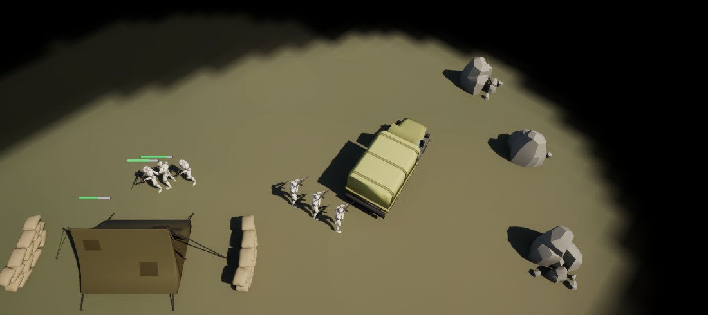
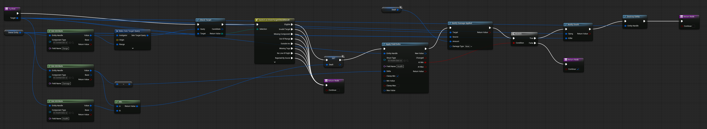
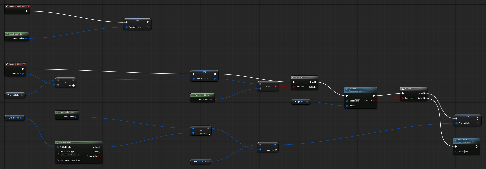
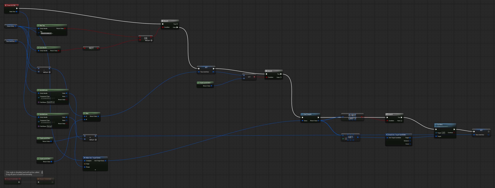

Complete [Add Movement](/guides/adding-movement/) first. This chapter gives the Soldier health and a rifle: 100 health, 10 damage per shot, 1.5 shots a second, 900 units of range. It attacks what you right-click and fires on its own at anything hostile nearby.

The framework has no health or weapon system. Combat is game data and abilities that you author; the framework supplies the pieces they use: component storage, targeting queries, field writes and death notifications.

## 1. Health and weapon components

Create the folder `Content/Demo/Components`. Right-click and choose **SeinARTS > SeinARTS Actor Component** for each:

| Component | Variables (Fixed Point, Instance Editable) |
| --- | --- |
| `SC_Health` | `MaxHealth` `100`, `Health` `100` |
| `SC_Combat` | `Damage` `10`, `RateOfFire` `1.5`, `Range` `900` |

A Sein component is simulation data: compiling it generates a data struct (`SC_HealthData`, `SC_CombatData`) that the simulation stores per entity, saves and checks across players. Use Fixed Point, never float, for anything gameplay reads.

Add both to `SU_Soldier`, compile and save.

## 2. The Attack order

Create an ability `SA_Attack` (**SeinARTS > SeinARTS Ability**, Generic Ability):

| Setting | Value |
| --- | --- |
| Ability Name | `Attack` |
| Target Type | Entity |
| Max Range | `900` |
| Requires Line Of Sight | On |
| Out Of Range Behavior | Auto Move Then |
| Granted Tags | `SeinARTS.Ability.Attack` |
| Cancel Abilities With Tag | `SeinARTS.Ability` |

**Auto Move Then** walks the unit into range with its Move Ability before activating. Add a Fixed Point variable `TimeUntilShot`.

### One shot: TryShot

Add a function `TryShot` with an input `Target` (Sein Entity Handle) and a Boolean output `Continue`:

1. Read the owner's weapon with **Get Attribute** (Entity **Owner Entity**, Component Type `SC_CombatData`, Field `Damage`, and again for `Range`). Get Attribute reads the field's effective value, after any upgrades.
2. **Make Sein Target Query**: Instigator **Owner Entity**, Range from `Range`, Required Component `SC_HealthData`. **Check Target** with the query and `Target`, then **Switch on ESeinTargetCheckResult**. Every result but **Eligible** returns `Continue` false.
3. On Eligible: add a local Fixed Point variable `Dealt` and set it to the **Min** of Damage and the target's `Health`, the damage this shot actually deals. Then **Apply Field Delta** on the target's `SC_HealthData` field `Health` with Delta **Negate** Damage and **Clamp Min** on, and after it **Notify Damage Applied** (Target, Source **Owner Entity**, Amount `Dealt`). `Dealt` is read before the write, so a killing shot still reports the health it took.
4. If **At Min**, the target is dead: **Notify Death** (Dying the target, Killer the owner), **Destroy Entity** on the target, and return false. Otherwise return true.

Apply Field Delta writes simulation state, so every player's simulation applies the same hit. The two Notify nodes only tell presentation what happened, for hit effects and death animations.

### The firing loop

In the Event Graph:

- **On Activate**: set `TimeUntilShot` to **Zero**, so the first shot comes at once.
- **On Tick**: subtract **Delta Time** from `TimeUntilShot`. When it is at or below zero, call `TryShot` with **Target Entity**. If it returns true, add **One** divided by the owner's `RateOfFire` to `TimeUntilShot`; otherwise **End Ability**.

On Tick runs at the simulation's fixed rate and Delta Time is fixed point, so every player fires on the same tick. Never use Delay, timers or Event Tick for gameplay.

## 3. Auto-Attack

A unit standing idle should defend itself. Right-click `SA_Attack` and choose **Create Child Blueprint Class**, named `SA_AutoAttack`. It inherits `TryShot` and `TimeUntilShot`. In its Class Defaults:

| Setting | Value |
| --- | --- |
| Ability Name | `Auto-Attack` |
| Is Passive | On |
| Target Type | None |
| Max Range | `0` |
| Requires Line Of Sight | Off |
| Out Of Range Behavior | Reject |
| Granted Tags | Empty |
| Cancel Abilities With Tag | Empty |

A passive ability activates when granted and ticks for the unit's lifetime. With no Granted Tags, no order cancels it, and Stop leaves it running.

Override **On Tick**:

1. Skip the tick when the owner **Has Tag** `SeinARTS.Ability`, meaning an order is running, or **Is In World** is false, for example while riding in a Truck.
2. Count `TimeUntilShot` down to zero, clamping with **Max** so it waits at zero.
3. At zero, **Find Targets** with the same query as `TryShot`. If the result **Is Not Empty**, call `TryShot` on the first candidate's **Target** and set `TimeUntilShot` to **One** divided by `RateOfFire`.

Find Targets returns the nearest eligible entities first. The default scorer skips only entities the unit's own player owns, and Required Component skips anything without health, such as mineral rocks. In a game with allied players, set the query's **Scorer Class** to a target scorer that also skips allies, or Auto-Attack fires on them.

## 4. Grant and map

On `SU_Soldier`'s Sein Abilities, add `SA_Attack` and `SA_AutoAttack` to Granted Abilities, and a Default Command:

| Required Context | Ability Tag | Priority |
| --- | --- | --- |
| Right Click, Target Enemy | `SeinARTS.Ability.Attack` | `10` |

Compile and save.

## 5. Test

Set the slot 2 start's **Spawn Entity** to `SU_Soldier` as well, and play. Walk your Soldier towards the other start and right-click the enemy Soldier: yours closes to `900` units and fires about every 0.67 seconds until one of them dies, ten hits later. Then order a fresh Soldier near the enemy without targeting it: once it stops, Auto-Attack opens fire.

## Checkpoint

- `SC_Health` and `SC_Combat` are Fixed Point simulation data on the Soldier.
- `SA_Attack` checks its target and writes Health with Apply Field Delta on a fixed-time loop.
- `SA_AutoAttack` fires only while the Soldier has no order.

Continue with [Add Mineral Income](/guides/adding-mineral-income/).
