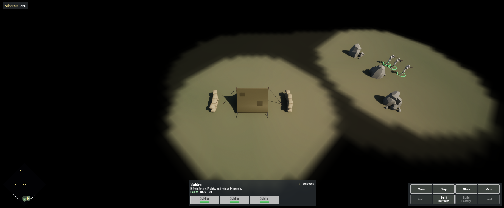
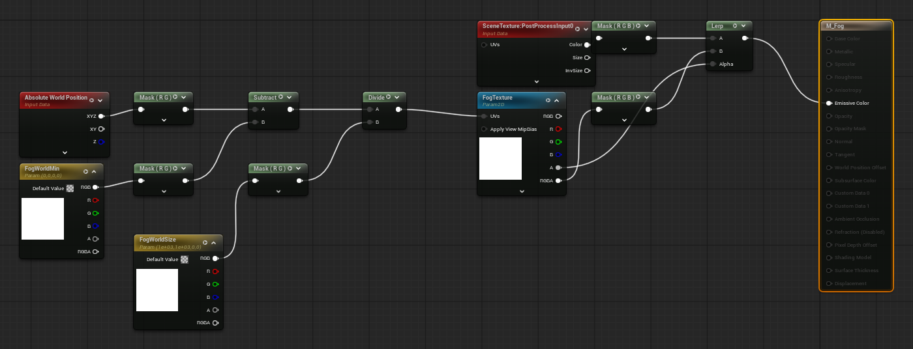
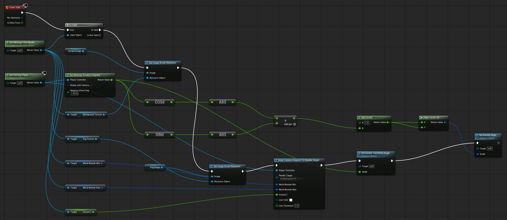
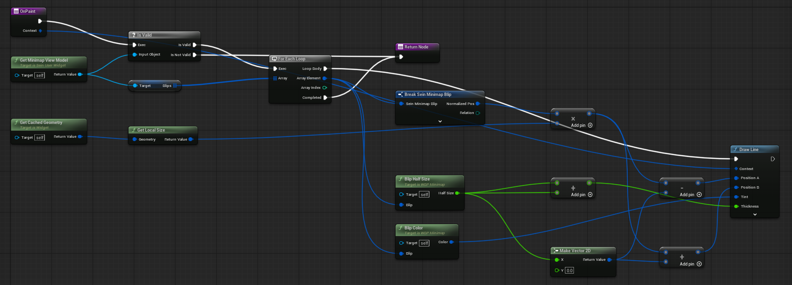

Complete [Add the Truck](/guides/adding-the-truck/) first. Every unit and building already carries a **Sein Vision** component (one radial stamp: radius `1000`, or `1200` on the Truck), and fog of war is on in Project Settings > Plugins > SeinARTS (Fog Of War Class `SeinFogOfWarDefault`). This chapter makes the fog visible and adds the minimap the HUD left room for.

## 1. Create the fog material

Create a Material `M_Fog` in `Content/Demo/Art/Materials`. Set **Material Domain** to **Post Process** and **Blendable Location** to **Scene Color After Tonemapping**.

Add three parameters with these exact names. The fog renderer fills them at runtime:

| Parameter | Type | Preview value |
| --- | --- | --- |
| `FogTexture` | Texture Sample Parameter 2D | `/Engine/EngineResources/WhiteSquareTexture` |
| `FogWorldMin` | Vector Parameter | `(0, 0, 0, 0)` |
| `FogWorldSize` | Vector Parameter | `(1000, 1000, 0, 0)` |

Build the graph:

1. **Absolute World Position** masked to RG, minus `FogWorldMin` masked to RG, divided by `FogWorldSize` masked to RG. This is the fog UV; connect it to `FogTexture`'s UVs.
2. **Scene Texture** with **PostProcessInput0**, masked to RGB.
3. **Lerp**: A = the scene colour, B = `FogTexture` RGB, Alpha = `FogTexture` A.
4. Connect the Lerp to **Emissive Color**.

## 2. Place the fog renderer

Open `LVL_Game`. From Place Actors, add a **Sein Fog Of War Render** (any position; its post-process volume is unbound). Label it `FogOfWar` and set **Fog Post Process Material** to `M_Fog`. Keep Unexplored Opacity `1` and Explored Opacity `0.75`. Save.

Play: everything outside your units' sight is black, ground you have seen but left is dimmed, and enemy units disappear when no unit of yours sees them.

## 3. Create the minimap widget

The minimap is a Sein User Widget that reads the **Minimap View Model**: the level's bounds, its baked top-down texture, a fog texture for the local player and one blip per visible entity.

Create a **Texture Render Target 2D** `RT_MinimapView` in `Content/Demo/UI`: `256 × 256`, format RGBA8, clear colour transparent. The camera's view box is drawn into it.

Create `WBP_Minimap`:

| Widget | Name | Settings |
| --- | --- | --- |
| Size Box (root) | `Box` | `220 × 220` |
| Overlay | `Layers` | |
| Border | `Background` | Brush colour near-black, fill both axes |
| Image | `TerrainImage` | Is Variable, fill, Not Hit-Testable |
| Image | `FogImage` | Is Variable, fill, Not Hit-Testable |
| Image | `ViewImage` | Is Variable, fill, Not Hit-Testable, brush resource `RT_MinimapView` |

The Background stays hit-testable so the widget receives clicks.

## 4. Draw the layers every frame

In **Event Tick**: **Get Minimap View Model**. If valid:

1. **Set Image Brush Resource** on `TerrainImage` with the view model's **Background Texture**, and on `FogImage` with its **Fog Texture**. Set Image Brush Resource accepts any texture, including render targets.
2. **Draw Camera Viewport To Render Target**: the owning player, `RT_MinimapView`, the view model's World Bounds Min, World Bounds Max and Ground Z, a white Line Color.
3. Turn the map with the camera. **Get Minimap Rotation Degrees** (owning player, Rotate With Camera on, Rotation Offset `-90`) gives the angle that keeps the camera's forward pointing up. **Set Render Transform Angle** to it.
4. A square turned 45° no longer fits its box. **Set Render Scale** to `1 / (|cos θ| + |sin θ|)` on both axes: two **Abs** of **Cos (Degrees)** and **Sin (Degrees)**, added, into **Safe Divide** with A = `1`.

## 5. Draw the unit markers

Add four Linear Color variables, Instance Editable: `FriendlyColor` (green), `EnemyColor` (red), `NeutralColor` (yellow) and `SelectedColor` (white).

Add two pure, const functions that take a **Sein Minimap Blip**:

- **Blip Color**: if the blip's **Selected** is true return `SelectedColor`; otherwise **Switch on ESeinRelation** returns the relation's colour.
- **Blip Half Size**: **Switch on ESeinMinimapBlipSize** returns `1.5`, `2.5` or `4.0` pixels for Small, Medium and Large.

Override **On Paint**. **Get Minimap View Model**; if valid, **For Each Loop** over its **Blips**:

1. Position = the blip's **Normalized Pos** × **Get Local Size** of **Get Cached Geometry**.
2. Offset = **Make Vector 2D** (Blip Half Size, 0).
3. **Draw Line** from Position − Offset to Position + Offset, Thickness = twice the half size, Tint = Blip Color, anti-alias off. A short thick line is a square marker, with no widget per blip.

Return after the loop. Because On Paint draws inside the widget, the markers turn and scale with the rest of the map.

## 6. Click to move the camera

Override **On Mouse Button Down**:

1. **Minimap Local To World**: Local Pos = **Absolute to Local** of the event's Geometry and the pointer's **Get Screen Space Position**; Widget Size = the Geometry's **Get Local Size**; the view model's World Bounds Min, World Bounds Max and Ground Z; Map Rotation Deg `0` (the widget's own transform is already in its local space); Circle Clip off.
2. Branch on its result AND **Is Mouse Button Down** (Left Mouse Button).
3. True: **Get Owning Player Pawn**, cast to **Sein Camera Pawn**, **Focus on World Point** with Out World, and return **Handled**.
4. Otherwise return **Unhandled**.

## 7. Add it to the HUD

In `WBP_HUD`, place `WBP_Minimap` (named `Minimap`) bottom-left, alignment `(0, 1)`, position `(16, -16)`, Size To Content. Compile and save.

## 8. Test

Play `LVL_Game`:

- The minimap is a diamond, because the camera starts at a 45° yaw; the view box sits over your base.
- Your units are green, mineral rocks yellow, enemy units red only while seen.
- Fog on the map matches fog in the world, including dimmed explored ground.
- Click the minimap: the camera jumps there. Rotate the camera with Q and E: the map turns with it.

## Checkpoint

- Fog is drawn from the local player's vision, after tonemapping.
- The minimap draws markers in On Paint, without a widget per unit.
- A minimap click moves only the local camera; it never orders units.

Continue with [Add Victory, Defeat and an AI](/guides/adding-victory-defeat-and-ai/).
