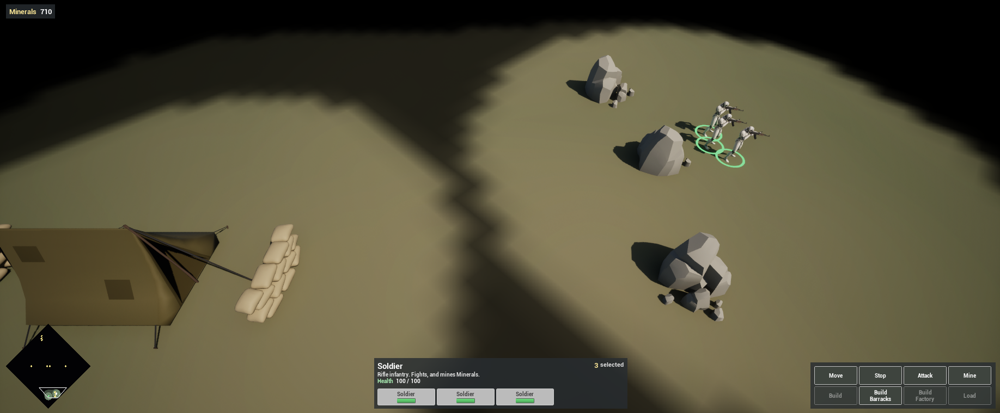
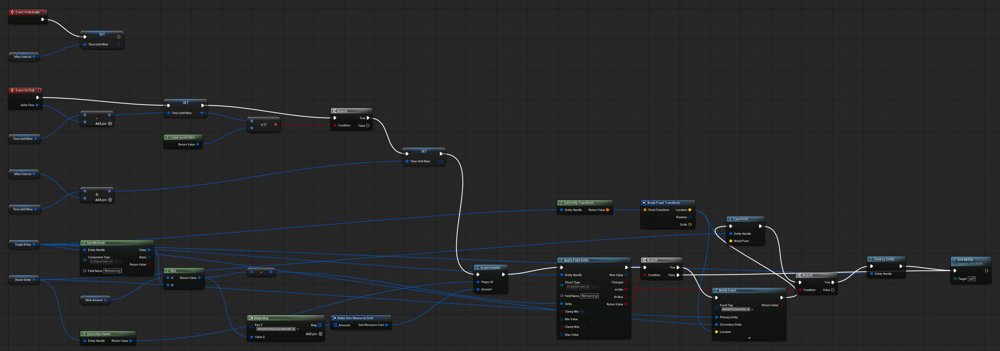

Complete [Add Combat](/guides/adding-combat/) first. This chapter adds the demo's one resource, Minerals: each player starts with 500, and a Soldier mining a rock earns 5 every 1.5 seconds until the rock's 1,500 run out.

## 1. Define Minerals

Open **Project Settings > Plugins > SeinARTS** and, in the **Economy** category, add an entry to **Resource Catalog**:

| Field | Value |
| --- | --- |
| Resource Tag | `SeinARTS.Resource.Minerals` (add the tag when prompted) |
| Display Name | `Minerals` |
| Default Starting Value | `500` |
| Default Cap | `0` (no cap) |
| Spend Behavior | Reject On Insufficient |
| Production Deduction Timing | At Enqueue |

The catalog defines every resource the game knows, and every player starts with each of them at its default.

## 2. The mineral rock

In `Content/Demo/Units`, create a **SeinARTS Entity Blueprint** (Generic Entity) named `SBP_MineralRock`:

| Component | Settings |
| --- | --- |
| Sein Identity | Display Name `Mineral Rock`, Description `Soldiers mine Minerals from it until it runs out.` |
| Static Mesh `RockMesh` | A rock model, scaled to about `250` units across; Collision **No Collision** |
| Sein Extents | One Capsule, Radius `120`, Height `150`; Blocks Nav on; Collision Enabled; Mobility **Static** |

Create a component `SC_Deposit` with one Fixed Point variable, `Remaining`, default `1500`, and add it to the rock.

**Blocks Nav** makes units path around the rock, and stop blocking once it is mined out. Because the rock is not baked into the level data, you can place and remove rocks without rebaking.

Place ten rocks in `LVL_Game`: three by each start, around `(-6500, -3900)` and `(6500, 3900)`, and four contested ones in between, at `(±250, ∓250)` and `(∓3200, ±3200)`. A rock placed in a level has no owner: it is neutral to every player.

## 3. The Mine ability

Create an ability `SA_Mine`:

| Setting | Value |
| --- | --- |
| Ability Name | `Mine` |
| Target Type | Entity |
| Max Range | `250` |
| Out Of Range Behavior | Auto Move Then |
| Granted Tags | `SeinARTS.Ability.Mine` |
| Cancel Abilities With Tag | `SeinARTS.Ability` |

Add three Fixed Point variables: `MineAmount` `5`, `MineInterval` `1.5` and `TimeUntilMine`.

- **On Activate**: set `TimeUntilMine` to `MineInterval`.
- **On Tick**: subtract Delta Time from `TimeUntilMine`. At or below zero:
  1. Add `MineInterval` back to `TimeUntilMine`.
  2. The take is the **Min** of `MineAmount` and the rock's `Remaining` (**Get Attribute** on **Target Entity**, `SC_DepositData`, `Remaining`).
  3. **Grant Income** to **Get Entity Owner** of the Owner Entity: **Make Sein Resource Cost** from a **Make Map** of `SeinARTS.Resource.Minerals` → the take.
  4. **Apply Field Delta** on the rock's `Remaining` by **Negate** of the take, Clamp Min on. If it failed, the rock is gone: **End Ability**. If it succeeded and is **At Min**, **Destroy Entity** on the rock, then End Ability.

Income goes to the player who owns the miner. Resources are simulation state, so every player sees the same balance.

## 4. Grant and map

On `SU_Soldier`, grant `SA_Mine` and add a Default Command:

| Required Context | Ability Tag | Priority |
| --- | --- | --- |
| Right Click, Target Neutral | `SeinARTS.Ability.Mine` | `5` |

Compile and save.

## 5. Test

Play, select your Soldier and right-click a rock by your start. It walks over and mines, swinging every 1.5 seconds. The Minerals counter arrives with the HUD; until then, `Sein.Commands.ShowLog` shows the Mine order, and the rock vanishes after its last Mineral.

## Checkpoint

- `SeinARTS.Resource.Minerals` is in the Resource Catalog, so every player starts with 500.
- `SBP_MineralRock` is a neutral entity with `SC_Deposit`.
- `SA_Mine` grants income on a fixed interval and removes an empty rock.

Continue with [Build the HUD](/guides/building-the-hud/).
