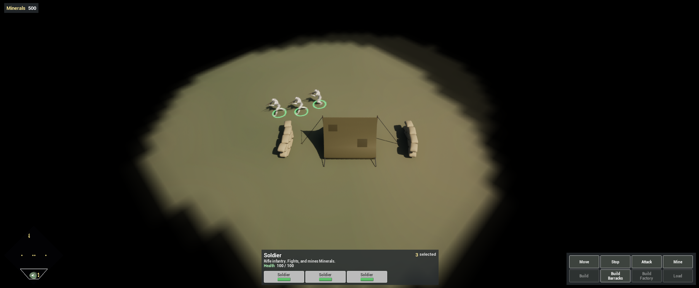
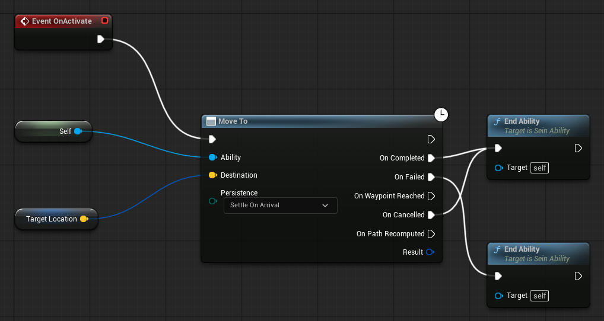

Complete [Create the Soldier](/guides/creating-the-soldier/) first. You have a selectable Soldier that idles. This chapter makes it walk where you right-click, and adds a Stop order.

Orders in SeinARTS are abilities: a Blueprint that the simulation activates with a target, runs over fixed-step ticks, and ends. A right-click picks an ability through the unit's command mappings; a button activates one directly.

## 1. Add movement and navigation

Open `SU_Soldier` and add **Sein Movement** and **Sein Navigation**.

On Sein Movement, leave **Movement Class** empty: the unit uses the framework's Basic Movement, which heads for each waypoint, steers around other units and slows to stop. Set **Speed** to `350` and **Turn Rate** to `5` (radians per second).

On Sein Navigation, keep the defaults: **Acceptance Radius** `50` and **Fallback Footprint Radius** `50`. The Sein Extents capsule already gives pathfinding the unit's size.

## 2. The Move ability

Create the folder `Content/Demo/Abilities`. Right-click, choose **SeinARTS > SeinARTS Ability**, pick **Generic Ability** and name it `SA_Move`. The factory generates its **Ability Tag**, `SeinARTS.Ability.Move`, from the name.

In **Class Defaults**:

| Setting | Value |
| --- | --- |
| Ability Name | `Move` |
| Target Type | Point |
| Granted Tags | `SeinARTS.Ability.Move` |
| Cancel Abilities With Tag | `SeinARTS.Ability` |

**Granted Tags** are tags the unit carries while the ability runs. **Cancel Abilities With Tag** cancels every running ability whose Granted Tags match. Every order in the demo grants a tag under `SeinARTS.Ability` and cancels that parent, so any new order replaces the one before it.

In the Event Graph, on **Event On Activate**, add **Move To** (Ability self, Destination **Target Location**). Wire its **On Completed**, **On Failed** and **On Cancelled** to **End Ability**.

Move To keeps running while the unit travels and fires one of its outputs when the move ends. End Ability releases the order.

## 3. The Stop ability

Create another ability, `SA_Stop`: Ability Name `Stop`, Target Type **None**, Cancel Abilities With Tag `SeinARTS.Ability`. On **Event On Activate**, call **End Ability**.

Stop does nothing itself. Activating it cancels whatever order the unit is running, and the unit stands where it is. Abilities that grant no tag, such as the passive Auto-Attack in the combat chapter, keep running.

## 4. Grant the abilities and map the right-click

On `SU_Soldier`, add **Sein Abilities**:

| Setting | Value |
| --- | --- |
| Granted Abilities | `SA_Move`, `SA_Stop` |
| Move Ability | `SA_Move` |
| Default Commands | One entry: Required Context `SeinARTS.Command.Context.RightClick` and `SeinARTS.Command.Context.Target.Ground`; Ability Tag `SeinARTS.Ability.Move` |

**Move Ability** is the ability the framework uses whenever the unit must walk on its own: into range of a target, or to a rally point.

A right-click builds a context from what is under the cursor (ground, a friendly, an enemy or a neutral entity, plus that entity's own tags) and activates the highest-priority Default Command whose Required Context it contains. Here, right-clicking ground activates Move with the clicked point.

Compile and save.

## 5. Test

Play and select the Soldier:

1. Right-click ground. It walks there, with locomotion blending from idle to walk to jog, and stops.
2. Right-click elsewhere before it arrives: the new order replaces the first.
3. Hold Shift and right-click two points: it visits them in order.
4. With several units selected, a right-drag lays them out in a formation whose front follows the drag.

Stop has no key binding; it gets a button when you build the HUD.

## Checkpoint

- `SU_Soldier` has Sein Movement (Speed `350`), Sein Navigation and Sein Abilities.
- `SA_Move` calls Move To and ends on completion or failure; `SA_Stop` only ends, cancelling the current order.
- A right-click on ground activates Move.

Continue with [Add Combat](/guides/adding-combat/).
