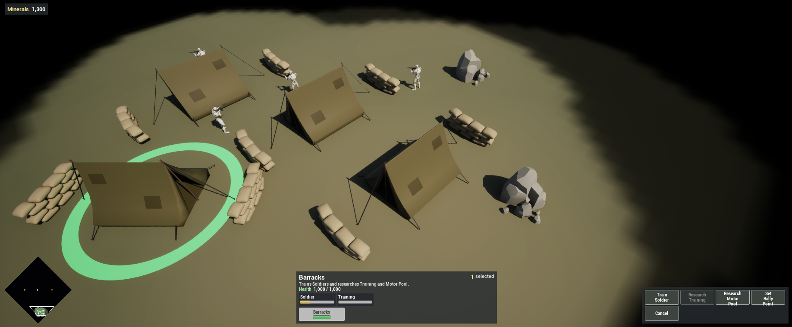
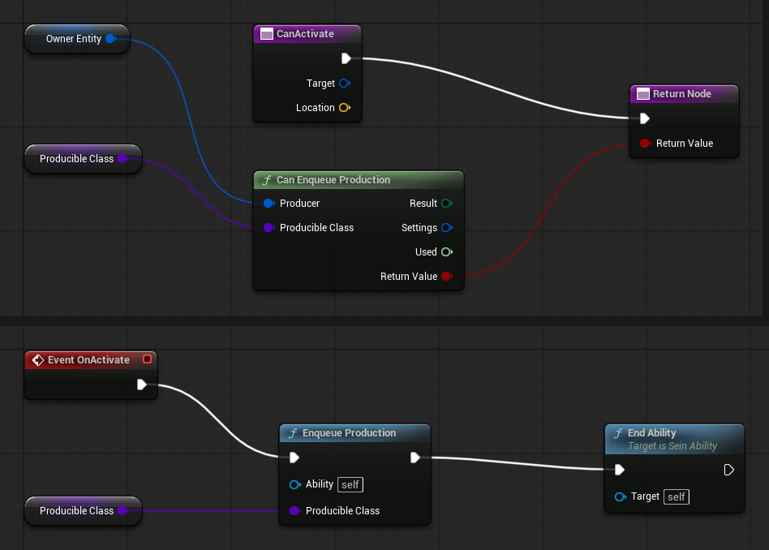

Complete [Build Production Buildings](/guides/building-production-buildings/) first. The Barracks will train Soldiers and research two technologies through one queue:

- **Training** makes Soldiers move and train 30% faster.
- **Motor Pool** unlocks the Factory.

## 1. Give the buildings a queue

Add **Sein Production** to both buildings:

| Building | Max Queue Size | Spawn Point Offset |
| --- | --- | --- |
| `SU_Barracks` | `5` | Location `(450, 0, 0)` |
| `SU_Factory` | `5` | Location `(600, 0, 0)` |

The spawn point lies outside the building's extents, in front of it. Add **Sein Abilities** to both; you grant their abilities below.

Make the Soldier producible: add **Sein Producible** to `SU_Soldier` with **Build Time** `6`.

## 2. The production ability

All production shares one parent. Create an ability `SA_Produce`:

| Setting | Value |
| --- | --- |
| Ability Name | `Produce` |
| Target Type | None |
| Dispatch Mode | Single |
| Cost Timing | Production Queue |
| Blocked Tags | `SeinARTS.State.UnderConstruction` |

Add a variable `ProducibleClass`, an **Actor** class reference.

- Override **Can Activate** to return **Can Enqueue Production** (Owner Entity, `ProducibleClass`). It is false while the queue is full, the player cannot pay, or a once-only research is already queued or done, so the HUD button greys out.
- On **On Activate**: **Enqueue Production** with `ProducibleClass`, then **End Ability**.

The ability only adds an entry; the production system advances the queue every tick and spawns the unit at the spawn point when its Build Time is done. **Cost Timing: Production Queue** charges the cost when the entry is queued and refunds it if the entry is cancelled. **Blocked Tags** keeps an unfinished building from producing.

Create a child, `SA_Produce_Soldier`: Ability Name `Train Soldier`, `ProducibleClass` `SU_Soldier`, Resource Cost `50` Minerals.

## 3. Rally points and cancelling

**Rally.** Create `SA_SetRally`: Ability Name `Set Rally Point`, Target Type Point. On Activate: **Set Rally Point** with **Make Fixed Transform** of **Target Location**, then End Ability. New units walk to the rally point with their Move Ability.

**Cancel.** Create `SA_CancelProduction`: Ability Name `Cancel`, Dispatch Mode Single. On Activate: **Get Production Data** of the Owner Entity, **Cancel Production** at index **Length** of its Queue minus `1`, then End Ability. It removes the newest entry and refunds its cost.

On both buildings, grant `SA_SetRally` and `SA_CancelProduction`, and add a Default Command: Right Click, Target Ground → `SeinARTS.Ability.SetRally`. With a building selected, a right-click on the ground sets its rally point.

Grant `SA_Produce_Soldier` on the Barracks.

## 4. Research as effects

A research item is an entity that is never spawned: finishing it applies an effect to its player.

Create the folder `Content/Demo/Research`.

**Effects.** Create two **SeinARTS > SeinARTS Effect** Blueprints (Generic Effect):

| Setting | `SE_Training` | `SE_MotorPool` |
| --- | --- | --- |
| Display Name | `Training` | `Motor Pool` |
| Description | `Soldiers move and train 30% faster.` | `Unlocks building the Factory.` |
| Scope | Class | Player |
| Default Target Class Tag | `SeinARTS.Unit.Soldier` | |
| Duration Mode | Persistent | Persistent |
| Granted Tags | `SeinARTS.Tech.Training` | `SeinARTS.Tech.MotorPool` |
| Forbidden Prerequisite Tags | `SeinARTS.Tech.Training` | `SeinARTS.Tech.MotorPool` |

Give `SE_Training` two **Modifiers**, both Target **Component**, Operation **Multiply**:

| Component Type | Field | Value |
| --- | --- | --- |
| `SeinMovementPayload` | `Speed` | `1.3` |
| `SeinProduciblePayload` | `BuildTime` | `0.77` |

A Class-scoped effect changes every unit of the target class its player owns, including units produced later. The modifiers change the fields' effective values, which the movement system and production queue read, so Soldiers move at `455` and train in about `4.6` seconds. The Soldier's authored values stay as they are.

`SE_MotorPool` changes nothing but the player's tags.

**Research items.** Create two **SeinARTS Entity Blueprints** (Generic Entity), `SR_Training` and `SR_MotorPool`. Give each a Display Name and Description matching its effect, and a **Sein Producible**:

| Setting | `SR_Training` | `SR_MotorPool` |
| --- | --- | --- |
| Build Time | `30` | `20` |
| Queue Policy | Once Per Player | Once Per Player |
| Is Research | On | On |
| Granted Tech Effect | `SE_Training` | `SE_MotorPool` |

**Research abilities.** Create two children of `SA_Produce`:

| Child | Ability Name | ProducibleClass | Cost |
| --- | --- | --- | --- |
| `SA_Research_Training` | `Research Training` | `SR_Training` | `150` Minerals |
| `SA_Research_MotorPool` | `Research Motor Pool` | `SR_MotorPool` | `100` Minerals |

Grant both on the Barracks. **Once Per Player** lets the player queue each research once across all their buildings; Can Enqueue Production enforces it.

## 5. Lock the Factory

Open `SA_Place_Factory` and set **Required Player Tags** to `SeinARTS.Tech.MotorPool`. Until Motor Pool completes, Build Factory is listed but disabled.

## 6. Test

Play:

1. Select the Barracks: Train Soldier, Research Training, Research Motor Pool, Set Rally Point and Cancel.
2. Right-click ground to set a rally point. Click **Train Soldier** twice: Minerals drop by 100, the queue row shows both, and each Soldier walks to the rally point six seconds apart.
3. Queue a Soldier and click **Cancel**: it leaves the queue and the 50 Minerals return.
4. Research **Motor Pool**. Before it completes, Build Factory is disabled for your Soldiers; afterwards it works.
5. Research **Training**: Soldiers visibly walk faster, and the next ones train faster.

## Checkpoint

- Costs live on abilities and build times on producible entities; `SA_Produce` children only name what to produce.
- Research is a producible entity that applies a persistent effect instead of spawning.
- Training modifies effective values on every Soldier; Motor Pool grants the tag that Build Factory requires.

Continue with [Add the Truck](/guides/adding-the-truck/).
