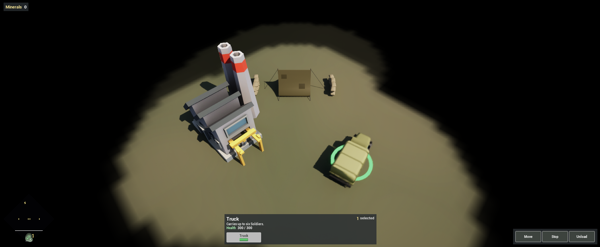
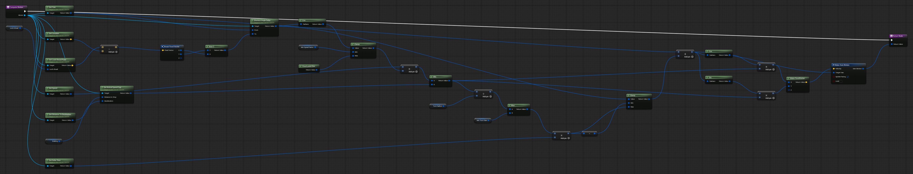
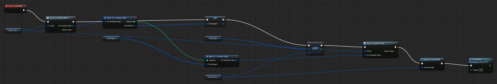
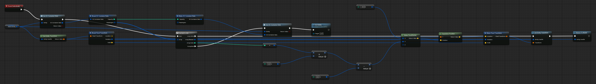

Complete [Add Production and Research](/guides/adding-production-and-research/) first. The Factory can be built but produces nothing yet. This chapter adds the Truck: a vehicle that steers like a bicycle, carries up to six Soldiers, and unloads them behind itself.

Everything here is Blueprint. The framework supplies the movement harness, the component storage and the ability lifecycle; the Truck's steering, its passenger list and how boarding works are the game's.

## 1. The passenger component

A transport needs to remember who is inside. In `Content/Demo/Components`, right-click and choose **SeinARTS > SeinARTS Actor Component**, name it `SC_Container`, and add two variables:

| Variable | Type | Default |
| --- | --- | --- |
| `Capacity` | Integer | `6` |
| `Passengers` | Sein Entity Handle array | empty |

Like `SC_Health`, it is simulation data: every player's copy holds the same passengers, and the framework saves and checks it with the rest of the state.

## 2. The steering movement mode

The Soldier uses the framework's basic movement: it heads straight for each waypoint and turns on the spot. A truck cannot turn on the spot. Its movement mode turns at a rate that grows with speed, as a bicycle does, and slows down for sharp turns.

In `Content/Demo/Movement`, right-click and choose **SeinARTS > Movement Mode** (parent **Sein Movement**) named `SM_TruckSteering`. Add five Fixed Point variables, Instance Editable:

| Variable | Default | Meaning |
| --- | --- | --- |
| `LookAhead` | `350` | How far ahead on the route the truck aims |
| `TurnRadius` | `350` | Turn rate is speed divided by this |
| `MinTurnRate` | `0.8` | Radians per second the truck can always turn, so it never circles a point it cannot reach |
| `MinSpeedFactor` | `0.25` | The slowest fraction of Speed it drops to in a sharp turn |
| `Braking` | `900` | Deceleration when arriving |

Override **Compute Motion**. It receives a **Mover** handle, which reads the unit's pose, speed and route, and returns a **Sein Motion**: a velocity and a facing. All of its math is fixed point.

1. **Heading error.** **Get Look Ahead Point** (Look Ahead `LookAhead`) minus **Get Location**, broken into X and Y. **Atan2** (Y, X) is the heading the truck wants. **Shortest Angle Delta** from **Get Yaw** to it is the error.
2. **Speed.** **Cos** of the error, **Clamp**ed between `MinSpeedFactor` and **One**, times **Get Speed**, is the cruise speed. **Get Arrival Speed Cap** (Distance To Stop from **Get Distance To Destination**, Deceleration `Braking`) caps it so the truck stops on the destination. Take the **Min** of the two.
3. **Turn.** Speed divided by `TurnRadius`, then the **Max** of that and `MinTurnRate`, times **Get Delta Time**, is the most the truck can turn this tick. **Clamp** the error between its negative and itself, and add it to the yaw.
4. **Drive.** Velocity is (**Cos** of the new yaw × speed, **Sin** of the new yaw × speed). **Make Sein Motion** with that Velocity, Target Yaw the new yaw, and **Update Facing** on.

The harness applies the motion, resolves collisions and keeps the truck on the navigation grid. A mode only says what the unit wants each tick.

## 3. The Truck

Create a Sein entity Blueprint `SU_Truck` in `Content/Demo/Units`. Add a Static Mesh for the model with collision off, then:

| Component | Settings |
| --- | --- |
| Sein Identity | Display Name `Truck`, Description `Carries up to six Soldiers.` |
| Sein Extents | One Box shape, Half Extent X `270`, Y `115`, Height `220`; Collision Enabled, Mobility Movable, Mass `400` |
| Sein Vision | One stamp, Radius `1200` |
| Sein Movement | Movement Class `SM_TruckSteering`, Speed `600`, Turn Rate `10` |
| Sein Navigation | Defaults |
| Sein Abilities | Granted `SA_Move`, `SA_Stop`, `SA_Unload` (below); Move Ability `SA_Move`; one Default Command: Right Click + Target Ground → `SeinARTS.Ability.Move` |
| SC_Health | Max Health and Health `300` |
| SC_Container | Defaults |
| Sein Producible | Build Time `10` |
| `HealthBar` (Sein Entity Widget) | As on the Soldier, Location Z `330` |
| `BPC_SelectionRing` | Location Z `3`, Scale `(4, 4, 1)` |

Turn Rate still caps how fast any movement mode can turn the Truck, in radians per second. The steering turns at most Speed ÷ `TurnRadius`, about `1.7`, so a cap of `10` never binds and the mode's own variables decide how it turns.

## 4. Board: SA_Load

The Soldier boards. Create an ability `SA_Load` in `Content/Demo/Abilities`. In its Class Defaults:

| Setting | Value |
| --- | --- |
| Ability Name | `Load` |
| Ability Tag | `SeinARTS.Ability.Load` |
| Target Type | Entity |
| Max Range | `150` |
| Out Of Range Behavior | Auto Move Then |
| Cancel Abilities With Tag | `SeinARTS.Ability` |

Auto Move Then walks the Soldier to the Truck first and activates when it arrives.

Override **Can Activate**: **Get SC Container Data** on the **Target** entity, break it, and return true when the get succeeded and the **Length** of Passengers is less than Capacity. A full truck, or a target that is not a transport, refuses the order.

In **On Activate**:

1. **Get SC Container Data** on **Target Entity** and break it. Set an array variable `Passengers` (Sein Entity Handle) on the ability from it, **Add** the **Owner Entity**, and **Set SC Container Data** on the target with the same Capacity and the new array.
2. **Remove From World** on the Owner Entity. The Soldier leaves the map but keeps its entity: its health, upgrades and owner stay as they are.
3. **End Ability**.

## 5. Unload: SA_Unload

The Truck unloads everyone at once. Create `SA_Unload`: Ability Name `Unload`, Target Type **None**, Cancel Abilities With Tag `SeinARTS.Ability`.

In **On Activate**, **Get SC Container Data** on the Owner Entity and **For Each Loop** over its Passengers. Each passenger gets a seat behind the truck:

1. Its local offset is X `-400`, Y `Index × 120 − 300`. **Transform Position** by the truck's **Get Entity Transform** turns it into a world location.
2. **Set Entity Transform** on the passenger to that location, with the truck's rotation.
3. **Return To World** on the passenger.

On **Completed**, **Set SC Container Data** on the truck with the same Capacity and an empty Passengers array, then **End Ability**.

## 6. Right-click to board

Open `SU_Soldier`. On its Sein Abilities component, add `SA_Load` to Granted Abilities and a Default Command:

| Required Context | Ability Tag | Priority |
| --- | --- | --- |
| Right Click, Target Friendly, `SeinARTS.Unit.Truck` | `SeinARTS.Ability.Load` | `10` |

The command context holds the target's own tags, its identity tag among them, so a mapping can require what the target is as well as whose it is. The Soldier's other friendly mapping, Build, also requires `SeinARTS.State.UnderConstruction`, so the two never match the same target.

## 7. Produce it at the Factory

Create a child of `SA_Produce` named `SA_Produce_Truck`: Ability Name `Build Truck`, `ProducibleClass` `SU_Truck`, Resource Cost `150` Minerals. Grant it on `SU_Factory`, beside its rally and cancel abilities.

## 8. Test

Play. Research Motor Pool, build a Factory and train a Truck. Select a few Soldiers and right-click the Truck: they walk to it and vanish inside. Drive the Truck somewhere, around a corner: it swings wide and slows in the turn instead of pivoting. Select it and press **Unload**: the Soldiers step out in a row behind it.

## Checkpoint

- `SM_TruckSteering` steers the Truck through **Compute Motion**; the framework applies it.
- `SC_Container` holds the passengers as simulation data.
- Soldiers board through a right-click mapping on the Truck's identity tag, and leave the world while inside.

Continue with [Add Fog and a Minimap](/guides/adding-fog-and-a-minimap/).
