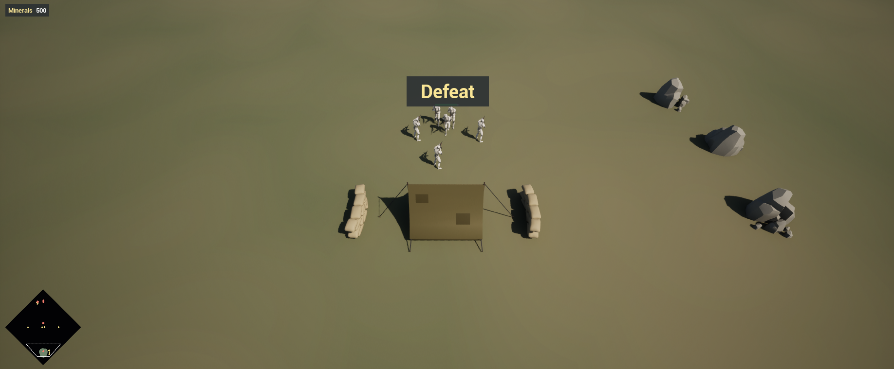
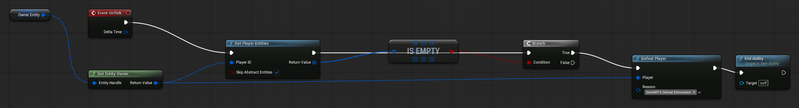
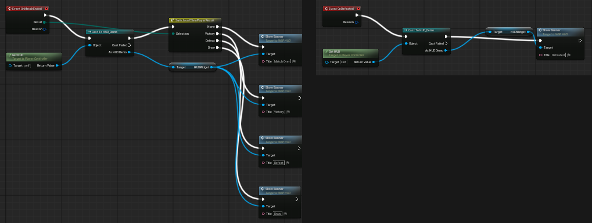
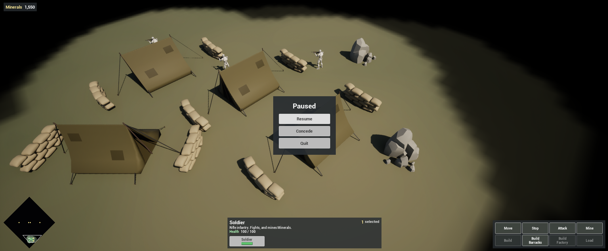
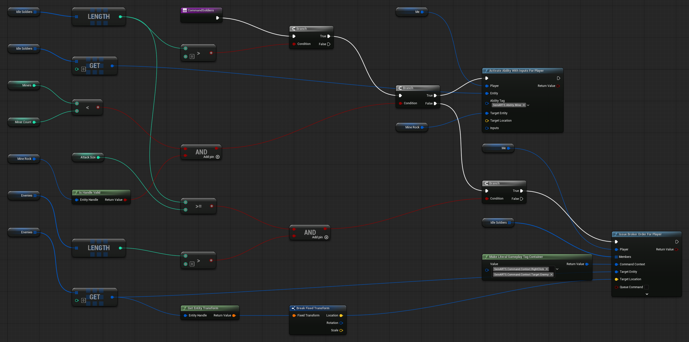

Complete [Add Fog and a Minimap](/guides/adding-fog-and-a-minimap/) first. The game has no ending yet, and slot 2 has no one to play it. This chapter adds the rule that defeats a player, the screens for the result and for pausing, and a simple computer opponent.

## 1. The elimination rule

A player is defeated when they own no units or buildings. Rules that belong to a player run as abilities on the Player State.

In `Content/Demo/Rules`, right-click and choose **SeinARTS > SeinARTS Ability**, pick **Generic Ability** and name it `SA_Elimination`. In its Class Defaults set Ability Name `Elimination`, **Is Passive** on and Target Type **None**. A passive ability activates when it is granted and runs its On Tick every simulation tick.

In **On Tick**: **Get Entity Owner** of the ability's **Owner Entity** (the player), then **Get Player Entities** for that player with Skip Abstract Entities on. If the array **Is Empty**, call **Defeat Player** with Reason `SeinARTS.Defeat.Eliminated` (add the tag when prompted) and **End Ability**.

Open `PS_Demo`, select its **Sein Abilities** component and add `SA_Elimination` to Granted Abilities, beside `SA_StartingForces`.

You do not author the win. With no match settings of your own, the match follows **End When One Team Remains**: once a player is defeated and every remaining player shares a team, they win and the match ends. Team `0`, the default, is a team of one. A defeated player's units are destroyed and their view follows the rest of the match.

## 2. The result banner

In `WBP_HUD` add, on the root Canvas:

- `ResultBanner`: a dark Border anchored at `(0.5, 0.25)`, alignment `(0.5, 0.5)`, Size To Content, Visibility **Collapsed**, holding a Text Block `ResultText` (size 40, gold). Mark both Is Variable.

Add a function **Show Banner** with a Text input `Title`: set `ResultText` to `Title` and set `ResultBanner` to **Not Hit-Testable (Self & All Children)** visibility.

The player controller hears about the result. In `PC_Demo`, add the events:

- **On Match Ended** (Result, Reason): **Get HUD**, **Cast To HUD_Demo**, get its `HUDWidget`, then **Switch on ESeinPlayerResult**. Each case calls **Show Banner**: `Victory`, `Defeat`, `Draw`, and `Match Over` for None (an aborted match).
- **On Defeated** (Reason): the same lookup, **Show Banner** `Defeated`. This fires when the player is out but the match goes on, which happens with three or more players.

After the match ends, the Game Mode waits **Post Match Seconds** (10 by default) and returns everyone to the lobby or the Main Menu Map.

## 3. The pause menu

In `WBP_HUD`, add `PauseMenu`: a dark Border anchored at the centre, alignment `(0.5, 0.5)`, Size To Content, Visibility **Collapsed**. Inside, a Vertical Box with the title `Paused` and three buttons in `220 × 44` Size Boxes: `ResumeButton`, `ConcedeButton` and `QuitButton`.

Add a custom event **TogglePauseMenu**: if `PauseMenu` **Is Visible**, collapse it and call **Request Resume**; otherwise make it Visible and call **Request Pause**. A pause is a lockstep request: in a network match it pauses every player.

The controller already turns the menu key into **On Menu Pressed**. In **Event Construct**, cast **Get Owning Player** to Sein Player Controller and **Bind Event to On Menu Pressed** with `TogglePauseMenu`.

Wire the buttons' **On Clicked**:

| Button | Does |
| --- | --- |
| Resume | TogglePauseMenu |
| Concede | TogglePauseMenu, then **Concede Match** |
| Quit | **Quit Game** for the owning player |

`IA_Menu` is already mapped to **Escape** and **F10** in `IMC_Demo`, so either key opens the menu.

## 4. A computer opponent

A computer player is an **AI Controller** whose brain you author. The Game Mode spawns its **AI Controller Class** for every AI slot once the match is built. It runs only on the host and issues orders with the same nodes a player's controller uses, so its reasoning need not be deterministic.

Create `AIC_Demo` in `Content/Demo/Core` with parent **Sein AI Controller**, and set it as `GM_Demo`'s **AI Controller Class**.

Add variables:

| Variable | Type | Default |
| --- | --- | --- |
| `ThinkEvery` | Integer, Instance Editable | `60` (ticks; 2 seconds at 30 Hz) |
| `AttackSize` | Integer, Instance Editable | `4` |
| `MinerCount` | Integer, Instance Editable | `4` |
| `Me` | Sein Player ID | |
| `Barracks`, `MineRock` | Sein Entity Handle | |
| `MineRockDistance` | Fixed Point | |
| `Miners` | Integer | |
| `IdleSoldiers`, `Enemies` | Sein Entity Handle array | |

Override **On Sim Tick**. Break the context, store **Owned Player ID** in `Me`, and branch on `Current Tick % ThinkEvery == 0`. True calls three functions in turn.

**Scan World** sorts what the AI knows about:

1. Reset `Miners` to `0`, **Clear** `IdleSoldiers` and `Enemies`, and reset `Barracks` and `MineRock`.
2. **For Each** entity in **Query All Entities** (an empty query matches everything: this AI sees through the fog), **Switch on** **Get Entity Relation** to `Me`:
   - **Enemy**: add it to `Enemies`.
   - **Friendly** with tag `SeinARTS.Unit.Soldier`: if it **Has Tag** `SeinARTS.Ability.Mine`, add one to `Miners`; else if it has no `SeinARTS.Ability` tag at all, it is idle, so add it to `IdleSoldiers`.
   - **Friendly** with tag `SeinARTS.Unit.Barracks`: store it in `Barracks`.
3. A second **For Each** keeps the `SeinARTS.Entity.MineralRock` nearest the Barracks: compare **Vector Distance Squared** of the two entities' locations against `MineRockDistance`.

**Train Soldiers**: if `Barracks` is valid, its **Get Production Data** queue is shorter than `2`, and **Get Resource** (`Me`, Minerals) is at least `50`, call **Activate Ability With Inputs For Player** (`Me`, `Barracks`, `SeinARTS.Ability.Produce.Soldier`).

**Command Soldiers**, with at least one idle Soldier:

- If `Miners < MinerCount` and `MineRock` is valid, send the first idle Soldier with **Activate Ability With Inputs For Player** (`SeinARTS.Ability.Mine`, Target Entity `MineRock`). The ability walks there first.
- Otherwise, once at least `AttackSize` Soldiers are idle and an enemy is known, **Issue Broker Order For Player** with all idle Soldiers, Command Context `SeinARTS.Command.Context.RightClick` and `SeinARTS.Command.Context.Target.Enemy`, and the first enemy as the target. That is a right-click on the enemy: their Attack ability takes it from there.

## 5. Field the AI without a lobby

The lobby decides who plays each slot. When you press Play on `LVL_Game` directly, the level's **Sein Player Starts** build the match instead. Select the slot 2 start and set its **Slot State** to **AI**. Save.

## 6. Test

Play `LVL_Game`:

1. After a few seconds, the AI's Soldiers walk to a rock near their base and mine, each at its own spot around it, and its Barracks keeps training.
2. Within about a minute, groups of four cross the map toward your base.
3. Press F10: the menu shows and the simulation pauses. Resume continues.
4. Press F10 and Concede: `Defeat` shows, and after ten seconds the game returns to the menu once the lobby exists.
5. Destroy everything the AI owns: `Victory` shows.

## Checkpoint

- Defeat is a rule on the Player State; victory follows from the match settings.
- The HUD shows the result and pauses through lockstep requests.
- The AI runs on the host and gives orders with the same nodes as a player.

Continue with [Create the Main Menu and Lobby](/guides/creating-the-skirmish-lobby/).
