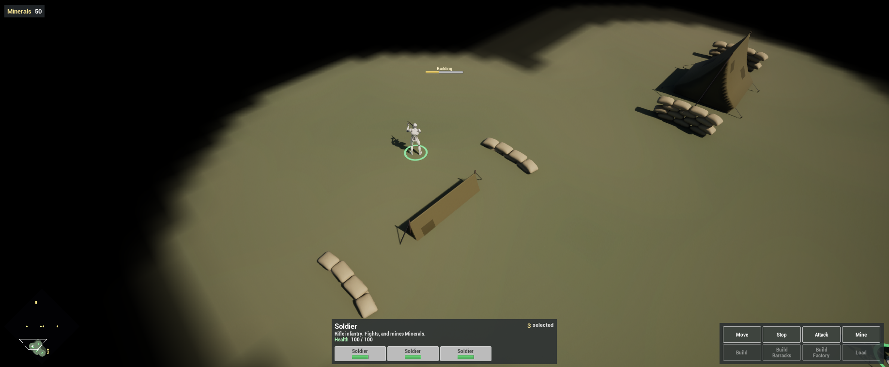
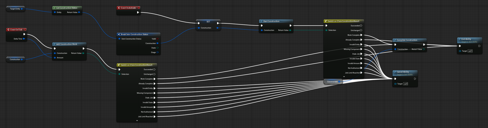
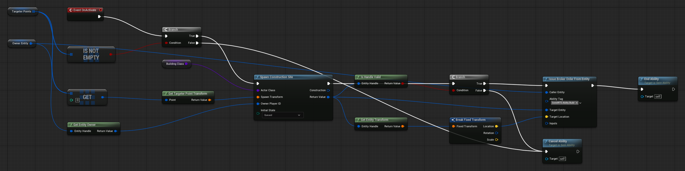
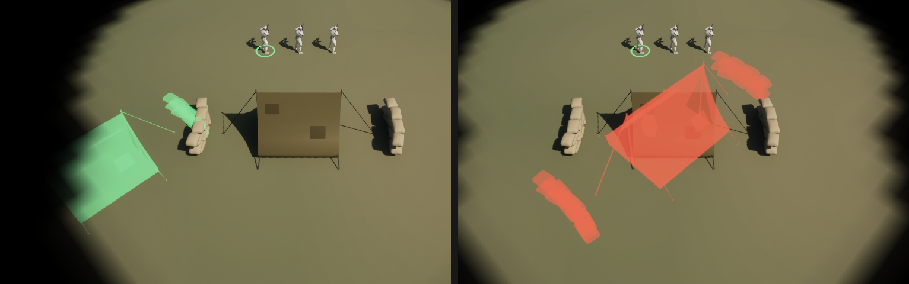

Complete [Build the HUD](/guides/building-the-hud/) first. This chapter adds the two buildings. A Soldier places one for Minerals; the building starts as a site and becomes usable once Soldiers have worked on it long enough. Each player now starts with a Barracks and three Soldiers.

## 1. The Barracks

In `Content/Demo/Units`, create a **SeinARTS Entity Blueprint** (Generic Entity) named `SU_Barracks`:

| Component | Settings |
| --- | --- |
| Sein Identity | Display Name `Barracks`, Description `Trains Soldiers and researches Training and Motor Pool.` |
| Static Meshes | The model: the demo uses a tent (scale `0.3`) flanked by two sandbag walls at Y `±470`; Collision **No Collision** |
| Sein Extents | One Box: Half Extent X `250`, Y `400`, Height `320`; Blocks Nav on; Collision Enabled; Mobility **Static** |
| Sein Vision | Default stamp, Eye Height `180` |
| Sein Construction | Required Work `20` |
| `SC_Health` | Max Health and Health `1000` |
| `HealthBar` (Sein Entity Widget) | As on the Soldier, Location Z `520` |
| `BPC_SelectionRing` | Location Z `3`, Scale `(8, 8, 1)` |

**Sein Construction** makes the entity buildable. Required Work is the work that completes it: a builder adds its Delta Time each tick, so one Soldier finishes a Barracks in 20 seconds and two in 10.

## 2. The Factory

Create `SU_Factory` the same way:

| Setting | Factory value |
| --- | --- |
| Display Name, Description | `Factory`, `Builds Trucks.` |
| Model | A factory mesh (the demo's is scaled `4.5`, raised `283`) |
| Sein Extents Box | Half Extent X `410`, Y `310`, Height `760` |
| Required Work | `30` |
| Health | `1500` |
| `HealthBar` Location Z | `600` |
| Selection ring Scale | `(9, 9, 1)` |

## 3. The construction bar

Create a widget `WBP_BuildProgress` with parent **Sein Construction Work Progress Widget**: a Vertical Box holding a Text Block `Label` and a Progress Bar named `ProgressBar` (`100 × 8`). In Class Defaults set **Progress Label Name** to `Label`.

Add a **Sein Entity Widget Component** `BuildProgress` to both buildings: Widget Class `WBP_BuildProgress`, Space **Screen**, Draw Size `110 × 26`, above the health bar (Z `640` and `720`). The parent class shows it while the building is under construction and hides it when it completes.

## 4. Build: SA_Build

Create an ability `SA_Build`:

| Setting | Value |
| --- | --- |
| Ability Name | `Build` |
| Target Type | Entity |
| Max Range | `200` |
| Out Of Range Behavior | Auto Move Then |
| Granted Tags | `SeinARTS.Ability.Build` |
| Cancel Abilities With Tag | `SeinARTS.Ability` |

Add a variable `Construction` of type **Sein Construction Handle**.

Override **Can Activate** to return **Is Under Construction** of the Target: the ability only builds unfinished sites.

In the Event Graph:

- **On Activate**: **Get Construction Status** of **Target Entity**, break it, store its Construction handle in `Construction`, and call **Start Construction** with it.
- **On Tick**: **Add Construction Work** to `Construction`, Amount **Delta Time**.

Switch on each call's **ESeinConstructionResult**: **Work Complete** calls **Complete Construction** then **End Ability**; **Already Complete** calls End Ability; every failure calls **Cancel Ability**. **Succeeded** and **Unchanged** leave the work going.

Several Soldiers can build one site; each adds its own work. The handle names one construction job, so a builder that arrives late, after the job finished, ends cleanly.

## 5. Place: SA_Place and its children

Placing is a separate order from building. Create an ability `SA_Place`, the shared parent for both buildings:

| Setting | Value |
| --- | --- |
| Ability Name | `Place Building` |
| Target Type | Point |
| Dispatch Mode | Single |
| Max Range | `400` |
| Out Of Range Behavior | Auto Move Then |
| Requires Free Footprint | On |
| Cancel Abilities With Tag | `SeinARTS.Ability` |
| Targeter Spec | **Point + Facing Targeter Spec** |

Add a variable `BuildingClass`, an **Actor** class reference.

**Single** dispatch sends the order to one selected Soldier, not all of them. The **Point + Facing** targeter lets the player click a spot and drag to turn the building. **Requires Free Footprint** refuses a spot the building's extents would overlap.

On **On Activate**:

1. If **Targeter Points** is empty, **Cancel Ability**.
2. **Spawn Construction Site**: Actor Class `BuildingClass`, Spawn Transform from **Get Targeter Point Transform** of the first targeter point, Owner Player ID from **Get Entity Owner** of the Owner Entity, Initial State **Queued**.
3. If the returned handle **Is Handle Valid**, **Issue Broker Order From Entity**: Caller Entity the Owner Entity, Ability Tag `SeinARTS.Ability.Build`, Target Entity the new site, Target Location its position. Then **End Ability**. Otherwise **Cancel Ability**.

The placer orders itself to build the site it just placed, through the same order path as a right-click.

Right-click `SA_Place` and create two child Blueprints:

| Child | Ability Name | BuildingClass and Footprint Actor Class | Resource Cost |
| --- | --- | --- | --- |
| `SA_Place_Barracks` | `Build Barracks` | `SU_Barracks` | `150` Minerals |
| `SA_Place_Factory` | `Build Factory` | `SU_Factory` | `250` Minerals |

**Footprint Actor Class**, under **Targeting** once Requires Free Footprint is on, gives the targeter its ghost: while placing, the player sees the building's meshes at the cursor. The cost is paid when the order activates and refunded if it is cancelled.

**Tint the ghost.** Untinted, the ghost looks the same on a free spot and a blocked one. In `Content/Demo/Art/Materials`, create a material `M_PlacementGhost`: Blend Mode **Translucent**, Shading Model **Unlit**, a Vector Parameter `Color` into Emissive Color and a Scalar Parameter `Opacity` (`0.45`) into Opacity. Create two instances of it: `MI_PlacementValid` with Color green and `MI_PlacementBlocked` with Color red.

In `Content/Demo/Abilities`, create a Blueprint `BP_PlacementPreview` with parent **Sein Point Facing Targeter Preview**. Select its **Mesh Preview** component and set **Valid** to `MI_PlacementValid` and **Blocked** to `MI_PlacementBlocked`. On both `SA_Place_Barracks` and `SA_Place_Factory`, expand **Targeter Spec** and set **Preview Class** to `BP_PlacementPreview`. The ghost is now green where the building fits and red where it would overlap something.

## 6. Grant and map

On `SU_Soldier`, grant `SA_Build`, `SA_Place_Barracks` and `SA_Place_Factory`, and add a Default Command:

| Required Context | Ability Tag | Priority |
| --- | --- | --- |
| Right Click, Target Friendly, `SeinARTS.State.UnderConstruction` | `SeinARTS.Ability.Build` | `10` |

A site carries `SeinARTS.State.UnderConstruction` until it completes, so right-clicking your own unfinished building sends Soldiers to help.

## 7. Start with a base

Each player now starts with a Barracks and three Soldiers.

Set both **Sein Player Starts**' **Spawn Entity** to `SU_Barracks`. A Spawn Entity is placed finished, not as a site.

The three Soldiers come from a rule on the player. Create the folder `Content/Demo/Rules` and an ability `SA_StartingForces`: Ability Name `Starting Forces`, **Is Passive** on, Target Type None. A passive ability on the Player State activates when the player is created. Its **On Tick**:

1. **Get Player Entities** of the Owner Entity's owner. **For Each Loop**; for each entity that **Has Tag** `SeinARTS.Unit.Barracks`:
2. **Spawn Entity** `SU_Soldier` three times, owned by that player, at **Transform Position** of the Barracks transform with the local offsets `(650, -200)`, `(650, 0)` and `(650, 200)`: a row in front of it.
3. On **Completed**, **End Ability**, so the rule runs once.

Open `PS_Demo`, add **Sein Abilities**, and grant `SA_StartingForces`.

## 8. Test

Play:

1. Each start has a Barracks with three Soldiers in front of it.
2. Select the Soldiers and click **Build Barracks**. A ghost follows the cursor, green on open ground and red over the starting Barracks. Click open ground, and drag before releasing to turn it. Minerals drop by 150.
3. One Soldier walks over and builds; the construction bar fills over 20 seconds. Right-click the site with the others: it fills faster.
4. Build Factory is listed and builds the same way. The next chapter locks it behind research.

## Checkpoint

- Both buildings are Static, nav-blocking entities with Sein Construction.
- `SA_Place_*` spawn a queued site and order the placer to build it; `SA_Build` adds work each tick.
- A player starts with a Barracks from its start and three Soldiers from `SA_StartingForces`.

Continue with [Add Production and Research](/guides/adding-production-and-research/).
