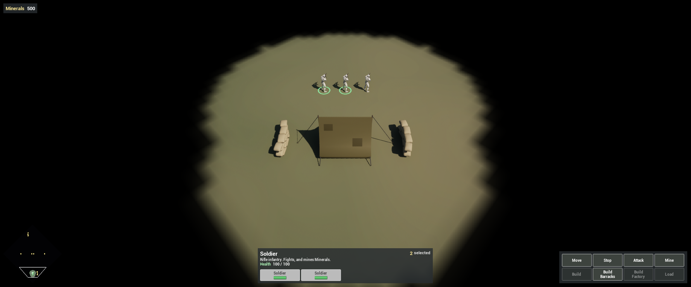
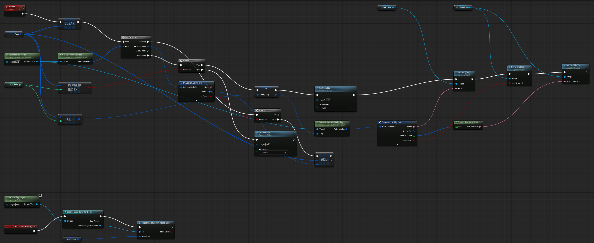
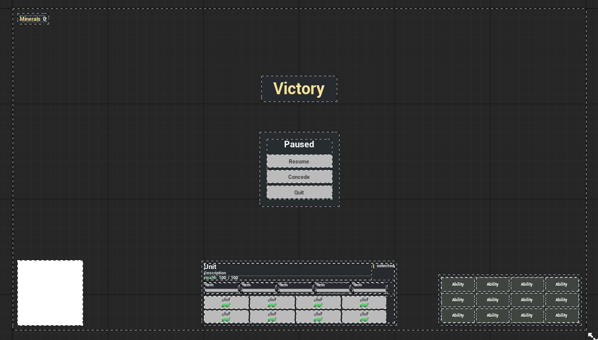
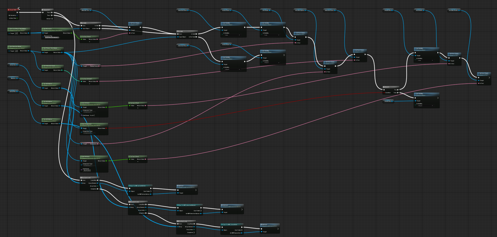

Complete [Add Mineral Income](/guides/adding-mineral-income/) first. This chapter builds the in-match HUD: the Minerals counter, an info panel for the selection, a banner per selected unit, the selected building's production queue and an action grid. The HUD lists whatever the selection can do, so the buildings, production and Truck in the next chapters appear in it without changes. A Sein User Widget reads everything from the framework's **view models**, which present the simulation read-only. The HUD never writes simulation state; its buttons only issue orders, like a right-click.

All widgets in this chapter are created in `Content/Demo/UI` with **Add > SeinARTS > View Model Widget** (under **User Interface**), keeping its parent **Sein User Widget**. A Widget Blueprint whose parent you set to Sein User Widget is the same thing.

## 1. Slot widgets that refresh from their parent

The action grid, the unit banners and the production queue each show a fixed number of slots. Each slot widget knows its index and fills itself from the selection.

Do not let a slot drive itself from **Event Tick**. Unreal stops ticking a widget once it is Collapsed, so a slot that hides itself would never show again. Give each slot a custom event named **Refresh** and let the always-visible HUD call it every frame.

## 2. The action button

Create `WBP_ActionButton`. In the Designer:

| Widget | Name | Settings |
| --- | --- | --- |
| Size Box (root) | `Box` | Width Override `112`, Height Override `48` |
| Button | `ActionButton` | Is Variable |
| Text Block inside the button | `ActionLabel` | Is Variable, auto-wrap |

Add the variables:

| Variable | Type | Notes |
| --- | --- | --- |
| `SlotIndex` | Integer | Instance Editable |
| `AbilityTag` | Gameplay Tag | The ability this slot shows |
| `Tags` | Gameplay Tag array | Scratch list |

Build **Refresh**:

1. **Clear** `Tags`. **Get Selection Model**, then **Get Selection Abilities**. **For Each Loop** over the result, **Break Sein Ability Info**, and **Add** its Ability Tag to `Tags` when **Is Passive** is false. Passive abilities, such as Auto-Attack, get no button.
2. On **Completed**, branch on **Is Valid Index** (`Tags`, `SlotIndex`).
3. True: set `AbilityTag` to `Tags[SlotIndex]`, set the widget **Visible**, then call **Get Selection Ability by Tag** with `AbilityTag` and break the result. Set `ActionLabel` to its Name, set `ActionButton`'s **Is Enabled** from Is Enabled, and set its tooltip from **Format Resource Cost** of the Resource Cost.
4. False: set the widget **Collapsed**.

Bind `ActionButton`'s **On Clicked**: **Get Owning Player**, **Cast To Sein Player Controller**, then **Trigger Ability From Action Slot** with `AbilityTag`. It fires an instant ability at once, or opens the ability's targeter (the Barracks placement ghost, for example) when it needs a target.

## 3. The selection banner

Create `WBP_SelectionBanner`: a Size Box (`150 × 44`) containing a Button `BannerButton`, which holds a Vertical Box with a Text Block `NameText` and a Progress Bar `HealthBar` (fill green). Mark the three named widgets Is Variable. Add an Instance Editable Integer `SlotIndex` and a `Unit` variable of type **Sein Actor** (object reference).

Build **Refresh**: **Get Owning Player**, cast to Sein Player Controller, **Get Valid Selected Actors**. If **Is Valid Index** (`SlotIndex`), store that actor in `Unit`, show the widget, set `NameText` from **Get Entity Display Name** of `Unit`'s **Get Entity Handle**, and set `HealthBar`'s Percent to **Safe Divide** (`Health`, `MaxHealth`). Read both with the **Get Entity View Model** node's **Get Attribute**, Component Type `SC_HealthData`, Field Name `Health` and `MaxHealth`. Otherwise collapse the widget.

On `BannerButton`'s **On Clicked**, cast the owning player to Sein Player Controller and call **Set Selection** with a one-element array of `Unit`: the click selects only that unit.

## 4. The production queue item

Create `WBP_QueueItem`: a Size Box (`120 × 40`) with a dark Border, a Vertical Box, a Text Block `ItemName` and a Progress Bar `Progress` (fill orange). Add an Instance Editable Integer `SlotIndex`.

**Refresh**: **Get Selection Model** > **Get Primary View Model**. If it is valid, call **Get Production Queue** on it. If **Is Valid Index** (`SlotIndex`), show the widget, break the entry with **Break Sein Production Queue Item Info**, and set `ItemName` from Display Name and `Progress` from Progress Percent. Collapse it otherwise, including when the selection is not a building. Only the front entry has progress; the rest show `0`.

## 5. The HUD layout

Create `WBP_HUD`. Its root is a Canvas Panel named `Root` with Visibility **Not Hit-Testable (Self Only)**, so clicks on empty screen reach the world. Add:

| Panel | Anchor and position | Contents |
| --- | --- | --- |
| `ResourcePanel` (dark Border) | Top left, `(16, 16)`, Size To Content | Text `Minerals`, Text Block `MineralsText` |
| `Minimap` (`WBP_Minimap`, next chapter) | Bottom left, alignment `(0, 1)`, `(16, -16)` | |
| `SelectionPanel` (dark Border) | Bottom centre, alignment `(0.5, 1)`, `(0, -16)`, Size To Content | Size Box width `640` > Vertical Box: the info row, `QueueRow`, `Banners` |
| `ActionPanel` (dark Border) | Bottom right, alignment `(1, 1)`, `(-16, -16)`, Size To Content | Uniform Grid Panel `ActionGrid` |

The info row is a Horizontal Box: a Vertical Box (Fill) with `InfoName`, `InfoDescription` (auto-wrap) and a `HealthRow` reading `Health  InfoHealth / InfoMaxHealth`, then `SelectionCount` and the text ` selected`.

Place the slot widgets inside their panels and set each instance's **Slot Index** in its Details:

| Panel | Children |
| --- | --- |
| `QueueRow` (Horizontal Box) | Five `WBP_QueueItem`, Slot Index `0`–`4` |
| `Banners` (Wrap Box, inner padding `4`) | Eight `WBP_SelectionBanner`, Slot Index `0`–`7` |
| `ActionGrid` (Uniform Grid, slot padding `2`) | Twelve `WBP_ActionButton`, Slot Index `0`–`11`, row `index / 4`, column `index % 4` |

Mark the named panels and text blocks Is Variable.

## 6. Fill the HUD every frame

In `WBP_HUD`'s **Event Tick**, start a **Sequence**.

**Then 0**, the read-outs:

1. **Get Local Player View Model**. If valid, **Get Resource** with `SeinARTS.Resource.Minerals`, **To Text (Float)** with Maximum Fractional Digits `0`, into `MineralsText`.
2. **Get Selection Model** > **Get Primary View Model**. If it is not valid, collapse `SelectionPanel` and `ActionPanel` and stop.
3. Otherwise show both panels and set `InfoName` and `InfoDescription` from the view model's **Display Name** and **Description**, and `SelectionCount` from **Get Selection Count**.
4. **Has Component** (`SC_HealthData`) decides whether `HealthRow` shows; when it does, fill `InfoHealth` and `InfoMaxHealth` from **Get Attribute** (`Health`, `MaxHealth`).

**Then 1**, the slots: for each of `ActionGrid`, `Banners` and `QueueRow`, **Get All Children**, **For Each Loop**, **Cast To** the slot's class, call **Refresh**.

## 7. Show the HUD

Open `HUD_Demo` (the HUD Class on `GM_Demo`). Add a variable `HUDWidget` of type `WBP_HUD`. On **Event BeginPlay**: **Create Widget** (Class `WBP_HUD`, Owning Player **Get Owning Player Controller**), store it in `HUDWidget`, then **Add to Viewport**. The HUD actor exists only for the local player, so each player builds one HUD.

Keep `HUD_Demo` derived from **Sein HUD**: it draws the selection marquee.

## 8. Health bars, selection rings and destination markers

The HUD covers the screen; three small pieces go on the units themselves.

**Health bar.** Create `WBP_HealthBar` with parent **Sein Entity Widget** (a Sein User Widget is not required here). Its tree is a Size Box `70 × 7` with a Progress Bar named exactly `ProgressBar`. Override the function **Get Progress Display**: read `Health` and `MaxHealth` with **Get Attribute** on **Bound Entity**, convert with **Fixed To Float**, and return **Make Sein Progress Display** with Visible = `Health < MaxHealth` and Percent = **Safe Divide** (`Health`, `MaxHealth`). The bar appears once a unit is damaged.

Add a **Sein Entity Widget Component** named `HealthBar` to `SU_Soldier`: Widget Class `WBP_HealthBar`, Space **Screen**, Draw Size `70 × 7`, Location Z `230`, above the model. Every unit you add later gets one too, raised to its height.

**Selection ring.** Create a material `M_SelectionRing`: Unlit, Masked, Two Sided. Its Opacity Mask is a ring cut from the UVs: **Distance** (Texture Coordinate, `(0.5, 0.5)`) through **Smooth Step** `0.40 → 0.43` minus Smooth Step `0.47 → 0.50`. Emissive is a green Vector Parameter `Color`.

Create a Blueprint `BPC_SelectionRing` with parent **Static Mesh Component**: Static Mesh `/Engine/BasicShapes/Plane`, material `M_SelectionRing`, **Visible** off, no shadow, collision **NoCollision**. Add variables `Unit` (Sein Actor) and `LocalController` (Sein Player Controller). On **BeginPlay**: cast **Get Owner** to Sein Actor into `Unit`, cast **Get Player Controller** (index 0) to Sein Player Controller into `LocalController`, and **Bind Event to On Selection Changed** with a custom event `UpdateRing`. `UpdateRing` sets the component's **Visibility** to whether **Get Valid Selected Actors** **Contains** `Unit`.

Add `BPC_SelectionRing` to `SU_Soldier`, Location Z `3` (just above the ground) and Scale `(1.2, 1.2, 1)`. Later units get one scaled to their footprint. The placement ghost copies only meshes that start visible, so the ring stays off it.

**Destination markers.** With units selected, the framework previews where each would stand if you right-clicked under the cursor: the same formation the order would use, reshaped as you right-drag. A unit draws its marker only if it carries a **SeinARTS Navigation Renderer**. Right-click `M_SelectionRing`, choose **Create Material Instance** and name it `MI_MoveMarker`; set its **Color** to white. Add a **SeinARTS Navigation Renderer** component to `SU_Soldier` with **Marker Material** `MI_MoveMarker`. The default renderer draws the marker on a plane sized to the unit's footprint. Every unit that moves gets one.

## 9. Test the HUD

Play `LVL_Game`:

1. Minerals reads `500`; with nothing selected, no panels show.
2. Select the Soldier. The info panel reads Soldier, its description and health, `1 selected`, one banner, a ring under the Soldier, and Move, Stop, Attack and Mine buttons. Auto-Attack is passive and gets none. Move the cursor over open ground: a white ring follows it, where the Soldier would stand.
3. Right-click a rock: the counter climbs by 5 every 1.5 seconds.
4. Click **Stop**: the Soldier stops mining and stands still.

Once you have several units, clicking a banner selects only that unit.

The production queue stays hidden until a building is selected; the next two chapters fill it.

## Checkpoint

- The HUD reads only view models; its buttons issue the same orders as a right-click.
- Slot widgets are refreshed by their parent, so a hidden slot comes back.
- Health bars, selection rings and destination markers sit on the units, not in the HUD.

Continue with [Build Production Buildings](/guides/building-production-buildings/).
