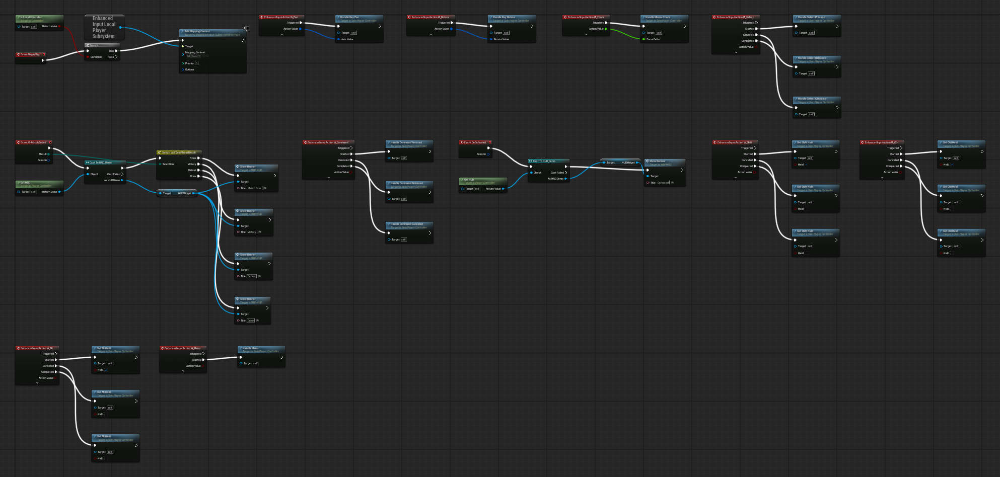

Start after [Create the Demo Project](/guides/creating-the-demo-project/). Your project has the framework enabled and its project settings configured.

This chapter creates the classes that run a match and wires the camera, selection, command and modifier keys. Everything is a Blueprint subclass of a framework class; none of it is simulation state.

## 1. Create the gameplay classes

In the Content Browser, create the folder `Content/Demo/Core`. In it, right-click, choose **Blueprint Class**, expand **All Classes**, search for the parent and create each Blueprint:

| Blueprint | Parent | Does |
| --- | --- | --- |
| `BP_DemoCamera` | Sein Camera Pawn | The RTS camera: pivot, spring arm, pan, rotate, zoom and ground following |
| `PC_Demo` | Sein Player Controller | Selection, commands and input for the local player |
| `HUD_Demo` | Sein HUD | Draws the selection marquee; later it creates the HUD widget |
| `PS_Demo` | Sein Player State | The player's entity on the simulation; later it carries the match rules |
| `GS_Demo` | Sein Game State | The match's shared state for widgets |
| `GM_Demo` | Sein Game Mode | Names the classes above and builds the match |

Open `BP_DemoCamera`. In **Class Defaults**, **Camera Pitch** sets the angled top-down view; keep its default `-50`. The camera applies it to the spring arm when play begins, so don't set the SpringArm's own rotation. The parent already supplies the pivot, spring arm and camera.

Open `GM_Demo`. In **Class Defaults** set:

| Setting | Value |
| --- | --- |
| Default Pawn Class | `BP_DemoCamera` |
| Player Controller Class | `PC_Demo` |
| HUD Class | `HUD_Demo` |
| Player State Class | `PS_Demo` |
| Game State Class | `GS_Demo` |

Compile and save each Blueprint. In **Project Settings > Maps & Modes**, set **Default GameMode** to `GM_Demo`.

## 2. Create the input actions

Create `Content/Demo/Input`. Right-click and choose **Input > Input Action** for each action:

| Action | Value Type | For |
| --- | --- | --- |
| `IA_Pan` | Axis2D (Vector2D) | Moving the camera |
| `IA_Rotate` | Axis2D (Vector2D) | Turning the camera |
| `IA_Zoom` | Axis1D (float) | Zooming |
| `IA_Select` | Digital (bool) | Click and marquee selection |
| `IA_Command` | Digital (bool) | Right-click orders |
| `IA_Shift`, `IA_Ctrl`, `IA_Alt` | Digital (bool) | Queueing and selection modifiers |
| `IA_Menu` | Digital (bool) | The pause menu, added later |

## 3. Create the mapping context

Choose **Input > Input Mapping Context** and name it `IMC_Demo`. Add these mappings; modifiers belong to the individual key mapping, in the order listed:

| Action | Keys | Modifiers |
| --- | --- | --- |
| `IA_Pan` | D, Right arrow | None |
| `IA_Pan` | A, Left arrow | Negate |
| `IA_Pan` | W, Up arrow | Swizzle Input Axis Values (YXZ) |
| `IA_Pan` | S, Down arrow | Negate, then Swizzle Input Axis Values (YXZ) |
| `IA_Rotate` | E | None |
| `IA_Rotate` | Q | Negate |
| `IA_Zoom` | Mouse Wheel Axis | None |
| `IA_Select` | Left Mouse Button | None |
| `IA_Command` | Right Mouse Button | None |
| `IA_Shift` | Left Shift, Right Shift | None |
| `IA_Ctrl` | Left Ctrl, Right Ctrl | None |
| `IA_Alt` | Left Alt, Right Alt | None |
| `IA_Menu` | Escape, F10 | None |

A key starts as a positive X value. **Negate** flips it; **Swizzle (YXZ)** moves it to Y, so one Axis2D action carries both pan directions.

## 4. Add the mapping context for the local player

Open `PC_Demo`'s Event Graph. On **Event BeginPlay**: **Is Local Controller** into a **Branch**; on True, **Get Enhanced Input Local Player Subsystem** and **Add Mapping Context** with `IMC_Demo`, Priority `0`.

Only the local player's controller adds the context. On a listen server, the host also holds a controller for every remote player.

## 5. Wire the actions to the controller's handlers

The parent controller implements selection, orders and camera control as **Handle** functions. Add each action's Enhanced Input event and call its handler, target self:

| Action | Pin | Call |
| --- | --- | --- |
| `IA_Pan` | Triggered | **Handle Key Pan** with the Action Value |
| `IA_Rotate` | Triggered | **Handle Key Rotate** with the Action Value |
| `IA_Zoom` | Triggered | **Handle Mouse Zoom** with the Action Value |
| `IA_Select` | Started / Completed / Canceled | **Handle Select Pressed** / **Released** / **Canceled** |
| `IA_Command` | Started / Completed / Canceled | **Handle Command Pressed** / **Released** / **Canceled** |
| `IA_Shift` | Started; Completed and Canceled | **Set Shift Held** true; false |
| `IA_Ctrl` | Started; Completed and Canceled | **Set Ctrl Held** true; false |
| `IA_Alt` | Started; Completed and Canceled | **Set Alt Held** true; false |
| `IA_Menu` | Started | **Handle Menu** |

Leave Triggered unconnected on Select and Command: a held button would restart its gesture every frame. Release and cancel must both clear a modifier, or it stays latched.

Handle Menu raises the controller's **On Menu Pressed** event; the pause menu binds it in a later chapter.

Compile and save everything.

## Checkpoint

- Six Blueprints in `Content/Demo/Core` with the parents above; `GM_Demo` names the other five.
- `IMC_Demo` maps every action, and BeginPlay adds it for the local player only.
- Every action calls its handler; Select and Command use Started, Completed and Canceled.

There is no map yet, so nothing runs. The next chapter adds the ground, the player starts and the level bake.

Continue with [Create the First Level](/guides/creating-the-first-level/).
