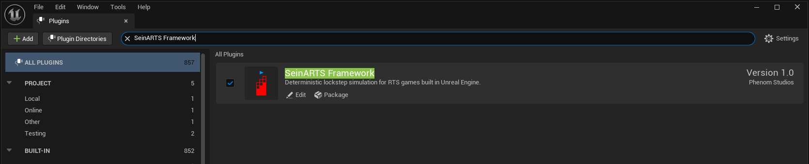

This series builds a small RTS demo from an empty project, all of it in Blueprint:

- Two maps: a main menu with a two-slot network lobby, and the game map.
- Soldiers that move, fight, mine Minerals and build, turning to face what they shoot, with a muzzle flash and a tracer for every shot; a Truck with its own steering that carries six of them.
- A Barracks and a Factory that rise out of the ground as they are built, a production queue, and two researches: Training and Motor Pool.
- A HUD with resources, selection, actions, the production queue and a minimap you click or drag to move the camera and right-click to send units; destination markers under the cursor; fog of war; health bars.
- Elimination defeat, victory, a pause menu and a computer opponent for slot 2.
- A packaged game that two players can play over a network.

You author the demo yourself from the framework's classes and Blueprint nodes. This first chapter installs the framework and prepares the project; its checkpoint is a configured editor, not a playable scene.

## 1. Prepare the tools and the framework package

This guide assumes you hold a SeinARTS license and have its release package: `SeinARTSFramework.zip`, prebuilt for **Unreal Engine 5.8** on Win64. `SeinARTSOnlineServicesExtension.zip` is optional and this series doesn't use it.

Install Unreal Engine 5.8 through the Epic Games Launcher. The demo is a C++ project so it can package a game that includes the framework; its generated game module stays unchanged while you author the gameplay in Blueprint. Install Visual Studio with the **Game development with C++** workload and the compiler and Windows SDK your Unreal Engine installation requires.

## 2. Create an empty project

1. Launch Unreal Engine 5.8.
2. In the project browser, choose **Games > Blank**.
3. Choose **C++**, target **Desktop**, and name the project `SeinDemo`.
4. Create the project and let the initial game module finish building.
5. Close the editor before installing the plugin.

The Blank template's generated C++ files provide the build target. The series authors the game-specific behavior in Blueprint.

## 3. Install and enable the framework

Create a `Plugins` directory beside `SeinDemo.uproject`, and extract `SeinARTSFramework.zip` into it. The zip holds one `SeinARTSFramework` folder with the plugin's binaries, source, content and configuration; keep them together.

The resulting layout must include:

```text
SeinDemo/
  SeinDemo.uproject
  Source/
  Config/
  Content/
  Plugins/
    SeinARTSFramework/
      SeinARTSFramework.uplugin
      Binaries/
      Config/
      Content/
      Resources/
      Source/
```

Check that the descriptor is directly inside `Plugins/SeinARTSFramework`, with no extra nested `SeinARTSFramework` directory.

1. Reopen `SeinDemo.uproject`.
2. Open **Edit > Plugins**, search for **SeinARTS Framework**, and enable it.
3. Confirm its declared dependencies, **Enhanced Input** and **Gameplay Tags Editor**, are enabled.
4. Restart the editor when prompted.

If Unreal reports that modules are missing or were built with a different engine version, the package doesn't match your engine: use Unreal Engine 5.8 and the package for it. If the project's own build fails, resolve its reported compiler or SDK error; with the editor closed, you can regenerate Visual Studio project files from the `.uproject`, open the solution, and build the `SeinDemo` project in **Development Editor / Win64** before reopening Unreal.

At this stage you need the core framework. Its built-in movement, navigation, and fog implementations are available without enabling the optional SeinARTS extensions.

All gameplay assets authored by this series belong to the project's own Content folder.

## 4. Configure Unreal's project settings

Open **Edit > Project Settings**. Configure the following values where they differ from your project's settings. Use the settings search to find the named property.

| Property | Value | Purpose |
| --- | --- | --- |
| World Settings Class | `SeinWorldSettings` | Gives newly created levels the framework's bootstrap controls. Restart the editor after changing this setting, before creating the gameplay map. |
| Default GameMode | `SeinGameMode` | Establishes the native gameplay base for the project. The next authoring step will create your own subclass. |
| Default Player Input Class | `EnhancedPlayerInput` | Enables the player input implementation used by Enhanced Input actions. |
| Default Input Component Class | `EnhancedInputComponent` | Enables Enhanced Input action bindings on the controller. |
| Import Tags From Config | Enabled | Loads the gameplay-tag sources written by the authoring tools. |

**Default GameMode** is on **Maps & Modes**. The two input defaults are on **Engine > Input**, under **Default Classes**. Search for **World Settings Class** directly; this is an engine setting and is different from a level's Game Mode Override.

For reference, the world-settings assignment is stored in the project's `Config/DefaultEngine.ini`:

```ini
[/Script/Engine.Engine]
WorldSettingsClassName=/Script/SeinARTSGameFramework.SeinWorldSettings
```

The input assignments are stored in `Config/DefaultInput.ini`:

```ini
[/Script/Engine.InputSettings]
DefaultPlayerInputClass=/Script/EnhancedInput.EnhancedPlayerInput
DefaultInputComponentClass=/Script/EnhancedInput.EnhancedInputComponent
```

Changing the default world-settings class does not establish a player slot or wire input events. Those are assets and level configuration that you will author in the following steps.

## Checkpoint

Before creating the first Blueprint, verify:

- `SeinDemo` opens as a Blank C++ project without build or module errors.
- **SeinARTS Framework**, **Enhanced Input**, and **Gameplay Tags Editor** are enabled.
- **World Settings Class** is `SeinWorldSettings`, and you have restarted the editor after changing it.
- **Default GameMode** is `SeinGameMode`.
- **Default Player Input Class** is `EnhancedPlayerInput`, and **Default Input Component Class** is `EnhancedInputComponent`.
- **Import Tags From Config** is enabled, as set in step 4.

There is no Soldier, movement ability, custom controller, or gameplay map yet. Creating those assets is the next part of building the demo.

Continue with [Create the Gameplay Classes and Input](/guides/creating-gameplay-classes-and-input/).
