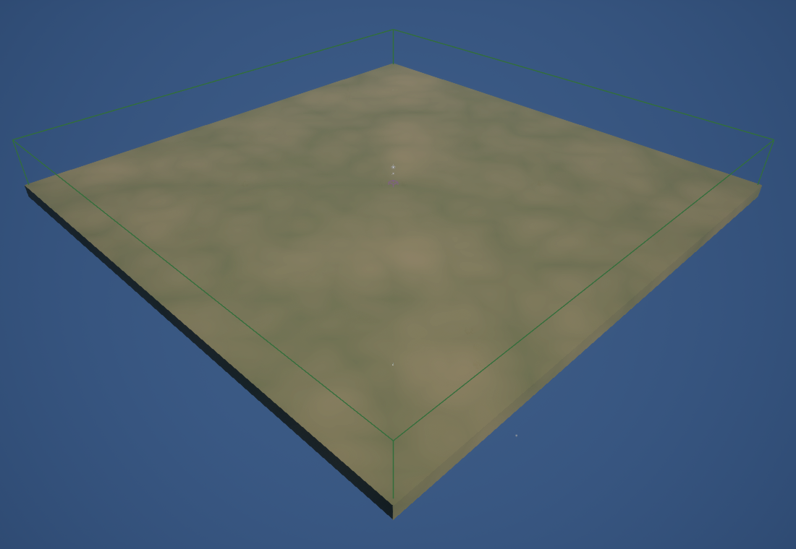

Complete [Create the Gameplay Classes and Input](/guides/creating-gameplay-classes-and-input/) first. You have your own game mode, camera, controller and input assets. This chapter gives them a map to run on.

## 1. Create the map

Choose **File > New Level > Basic**: a floor, a sky and lighting. Save it as `Content/Demo/Maps/LVL_Game`.

Select the template's **Floor** and set its Scale to `(16, 16, 8)`, a field `16,000` units across. Its top surface stays at Z `0`.

For a ground that reads well from above, create a material `M_Ground` in `Content/Demo/Art/Materials`: **Lerp** between two dark olive **Constant3Vector** colours, `(0.085, 0.1, 0.05)` and `(0.13, 0.125, 0.07)`, with a **Noise** node (Scale `0.00025`) as Alpha, into Base Color; Roughness `0.95`. Assign it to the Floor.

In **World Settings**, set **GameMode Override** to `GM_Demo`. Leave **Auto-Start Simulation** on: a map you play directly starts its match at BeginPlay.

## 2. Add the player starts

Delete the template's **Player Start**. From **Place Actors**, add two **Sein Player Starts** on the floor surface (Z `0`):

| Start | Location | Yaw | Player Slot | Team |
| --- | --- | --- | --- | --- |
| Slot 1 | `(-5600, -5600, 0)` | `45` | `1` | `1` |
| Slot 2 | `(5600, 5600, 0)` | `-135` | `2` | `2` |

Each faces the map's centre. A Sein Player Start seats one player: when you play the map directly, the match is built from these starts, one player per slot. A lobby replaces them with its own roster later.

The starts spawn nothing yet. The Soldier chapter gives them a starting unit.

## 3. Bound the playable area and bake

Add a **Sein Level Volume** at the origin. It arrives as a `200`-unit cube; set its Scale to `(79, 79, 10)`, a box `15,800` units across and `2,000` tall, so it fits inside the floor's edges and spans well above and below its surface.

Select the volume and press **Bake Level Data**. The bake traces the ground and writes the navigation and fog grids into a level data asset under `Content/SeinARTS/LevelData`; the volume's **Baked Asset** then names it. Save the map.

Rebake whenever the ground, static obstacles or the volume change. The baked data is generated, so it is not checked in; every player's build must come from the same bake.

## 4. Play

Press **Play** with one player in **Selected Viewport** or **Standalone**:

- W/A/S/D and the arrow keys pan, Q/E rotate, and the mouse wheel zooms.
- Dragging with the left button draws a selection marquee; releasing ends it.

The Output Log reports the navigation and fog grids loading and the simulation starting.

## Checkpoint

- `LVL_Game` uses `GM_Demo` and a `16,000`-unit floor.
- Two Sein Player Starts seat slots 1 and 2 on teams 1 and 2.
- The level volume has a Baked Asset.
- The camera pans, rotates and zooms, and the marquee draws.

Continue with [Create the Soldier](/guides/creating-the-soldier/).
