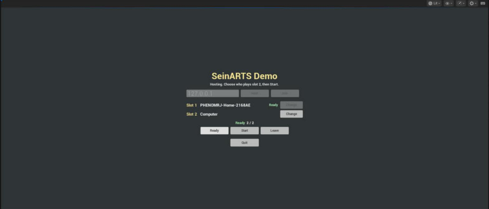
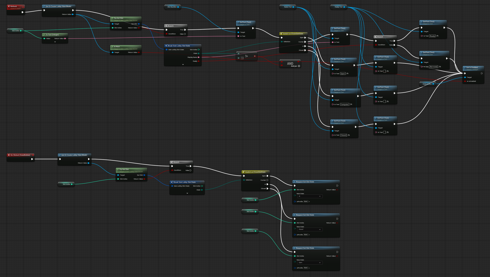
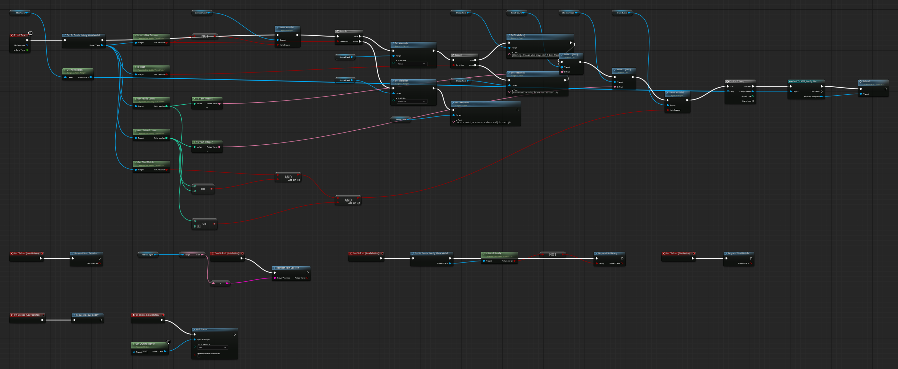

Complete [Add Victory, Defeat and an AI](/guides/adding-victory-defeat-and-ai/) first. Until now you pressed Play on `LVL_Game`. A real match starts from a lobby: one player hosts, others join by address, the host decides who plays each slot, and the host starts. The framework runs the lobby; you build its screen.

## 1. Register the maps

Open **Project Settings > Plugins > SeinARTS**, category **Network > Lobby**, and set:

| Setting | Value |
| --- | --- |
| Available Maps | One entry: Map `LVL_Game`, Display Name `Demo 1v1`, Slot Count `2`, Team Count `2` |
| Default Gameplay Map | `LVL_Game` |
| Main Menu Map | `LVL_MainMenu` (created below) |

In **Project Settings > Maps & Modes**, set **Game Default Map** to `LVL_MainMenu`, so a packaged game opens the menu.

Available Maps tells the lobby how many slots to offer. Main Menu Map is where players return after a match or when they leave.

## 2. The menu classes and map

Create in `Content/Demo/Core`:

- `PC_Menu`, parent **Sein Player Controller**, with a variable `Menu` of type `WBP_MainMenu` (created next).
- `GM_Menu`, parent **Sein Game Mode**: Player Controller Class `PC_Menu`, Default Pawn Class **None**.

Create a new **Empty Level** and save it as `Content/Demo/Maps/LVL_MainMenu`. In its World Settings, set **GameMode Override** to `GM_Menu` and turn **Auto-Start Simulation** off: the menu must not run a match. It needs no level volume, units or player starts.

On `PC_Menu`'s **Event BeginPlay**, when **Is Local Controller**: **Create Widget** (`WBP_MainMenu`, Owning Player self) into `Menu`, **Add to Viewport**, set **Show Mouse Cursor** on, and **Set Input Mode UI Only** with `Menu` as the widget to focus.

## 3. The lobby slot row

Create `WBP_LobbySlot`, a Sein User Widget. Its root is a Horizontal Box with: `Slot` and `SlotNumber` labels, a `NameText` (Fill), a `ReadyText` and a `StateButton` (`120 × 40`) labelled `Change`. Add an Instance Editable Integer `SlotIndex`.

Add a custom event **Refresh**:

1. **Get Or Create Lobby View Model** (an exec node; put it in the chain), then **Try Get Slot** with `SlotIndex`. If found, **Break Sein Lobby Slot State**.
2. Set `SlotNumber` from `SlotIndex`. **Switch on ESeinSlotState**: Open shows `Open`, AI shows `Computer`, Closed shows `Closed`, and each clears `ReadyText`. Human shows the slot's **Display Name** and `Ready` or `Not ready` from **Ready**.
3. Enable `StateButton` only when the view model **Is Host** and the slot's State is not Human. The comparison is a byte compare; Human is `1`.

On `StateButton`'s **On Clicked**, read the slot again and **Switch on ESeinSlotState**: **Request Set Slot State** to AI from Open, Closed from AI, and Open from Closed. Players are seated automatically when they host or join, so no Claim button is needed.

## 4. The main menu widget

Create `WBP_MainMenu`. Its root is a full-screen dark Border centring a `620`-wide Size Box with a Vertical Box:

| Widget | Name |
| --- | --- |
| Text | Title `SeinARTS Demo` |
| Text Block | `StatusText` |
| Horizontal Box | `ConnectPanel`: Editable Text Box `AddressInput` (text `127.0.0.1`), buttons `HostButton` and `JoinButton` |
| Vertical Box, Collapsed | `LobbyPanel`: a Vertical Box `SlotRows` with two `WBP_LobbySlot` (Slot Index `1` and `2`), the row `Ready  ReadyCount / ClaimedCount`, and buttons `ReadyButton`, `StartButton`, `LeaveButton` |
| Button | `QuitButton` |

On **Event Tick**, after **Get Or Create Lobby View Model**:

1. Enable `ConnectPanel` only while not **Is In Lobby Session**.
2. Out of a session: collapse `LobbyPanel` and set `StatusText` to `Host a match, or enter an address and join one.`
3. In a session: show `LobbyPanel`. Set `StatusText` by **Is Host**: `Hosting. Choose who plays slot 2, then Start.` or `Connected. Waiting for the host to start.` Fill `ReadyCount` and `ClaimedCount` from **Get Ready Count** and **Get Claimed Count**.
4. Enable `StartButton` when **Can Start Match**, Ready Count equals Claimed Count (computer slots count as ready), and Claimed Count is at least `2`: a lone player would win at once.
5. For each child of `SlotRows`, cast to `WBP_LobbySlot` and call **Refresh**.

Wire the buttons:

| Button | Node |
| --- | --- |
| Host | **Request Host Session** |
| Join | **Request Join Session**, Server Address = `AddressInput`'s Text converted to String |
| Ready | **Request Set Ready** with NOT **Is Local Ready** |
| Start | **Request Start Match** |
| Leave | **Request Leave Lobby** |
| Quit | **Quit Game** |

## 5. Test against the computer

Open `LVL_MainMenu` and Play:

1. Click **Host**. Slot 1 shows your name, Not ready; slot 2 is Open.
2. Click slot 2's **Change**: it becomes Computer. Click **Ready**: Ready reads `2 / 2` and Start enables.
3. Click **Start**. The game travels to `LVL_Game`; the computer plays slot 2.
4. Concede from the pause menu: after the Defeat banner, everyone returns to the lobby, still seated.

## 6. Test two players

Play two standalone windows, or two copies of a packaged build. One clicks **Host**. The other enters the host's address (`127.0.0.1` on the same machine) and clicks **Join**: it takes slot 2. Both click Ready, and the host clicks Start. Each player controls only their own forces, and each sees only their own fog.

If a player drops mid-match, the match goes on without them, and **Project Settings > SeinARTS > Network > Vacant Seat Policy** decides what happens to their seat: whether the Game Mode's AI Controller Class takes it over, whether a new player may take it, each after a delay, and when the player who dropped may come back. The demo keeps the default: the computer takes over after 30 seconds, and the player may rejoin at any time and take the seat back. To decide per match or per seat, override **Get Vacant Seat Policy** in the Game Mode.

## Checkpoint

- The menu map runs no simulation.
- Host, Join, Ready, Start and Leave are framework requests; the widget only shows the lobby.
- The host chooses who plays an empty slot; the started match uses the lobby's roster, not the level's starts.

Continue with [Package and Play Over a Network](/guides/packaging-and-verifying-the-demo/).
