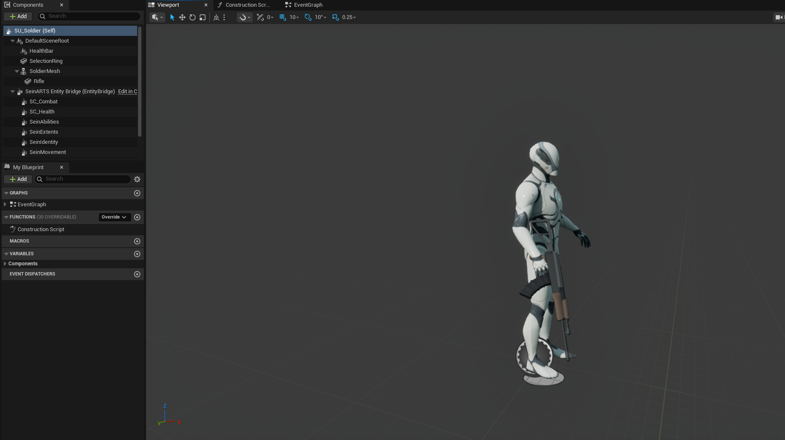
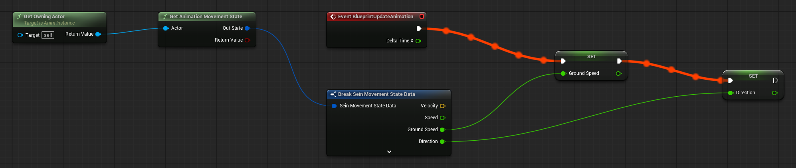

Complete [Create the First Level](/guides/creating-the-first-level/) first. You have a map with a camera and two player starts. This chapter adds a Soldier you can see and select; the next one makes it move.

## 1. Create the unit Blueprint

Create the folder `Content/Demo/Units`. Right-click and choose **SeinARTS > SeinARTS Entity Blueprint**, pick **Generic Entity** and name it `SU_Soldier`.

Its parent is **Sein Actor**, with an inherited **Entity Bridge** that ties the actor to its simulation entity. The factory also adds **Sein Identity** and generates the tag `SeinARTS.Unit.Soldier` from the asset name. Select Sein Identity and enter:

| Field | Value |
| --- | --- |
| Display Name | `Soldier` |
| Description | `Rifle infantry. Fights, and mines Minerals.` |

The tag names the unit type for rules and command mappings; Display Name is what the HUD shows.

## 2. Add the mannequin and rifle

The Soldier uses Unreal's mannequin and its rifle animations. In the Content Browser choose **Add > Add Feature or Content Pack**, pick **Third Person** and **Add to Project**. It adds the mannequin, its skeleton and its Unarmed, Pistol and Rifle animations under `Content/Characters/Mannequins`.

In `SU_Soldier`, add:

| Component | Settings |
| --- | --- |
| Skeletal Mesh `SoldierMesh` | Mesh `SKM_Manny_Simple`, rotation Yaw `-90` |
| Static Mesh `Rifle`, child of `SoldierMesh` | Mesh: any rifle model (the demo uses a low-poly one); Parent Socket `hand_r`; rotation Pitch `-18`, Yaw `180`; Scale `0.18`; Collision **No Collision** |

Yaw `-90` turns the mannequin to face the actor's forward axis, with its feet at the origin. The rifle rides in the right hand; tune its rotation to your model.

## 3. Animate from the simulation

Create `Content/Demo/Art/Animations`.

**Blend Space.** Create a Blend Space on the mannequin's `SK_Mannequin` skeleton, named `BS_Soldier_Locomotion`:

| Axis | Name | Min | Max | Grid divisions |
| --- | --- | --- | --- | --- |
| Horizontal | Direction | `-180` | `180` | `8` |
| Vertical | Speed | `0` | `600` | `4` |

Place samples from `Characters/Mannequins/Anims/Rifle`: `MF_Rifle_Idle_ADS` along Speed `0` at every Direction; the eight `MF_Rifle_Walk_*` animations at Speed `300` (Fwd at `0`, Fwd_Right at `45`, Right at `90`, Bwd_Right at `135`, Bwd at `±180`, and the left-hand ones at the negative angles); and the `MF_Rifle_Jog_*` animations at Speed `600` in the same pattern.

**Animation Blueprint.** Create an Animation Blueprint on the same skeleton named `ABP_Soldier`, with two Float variables, `GroundSpeed` and `Direction`.

In its Event Graph, on **Event Blueprint Update Animation**: **Get Owning Actor** into **Get Animation Movement State**, **Break Sein Movement State Data**, and set `GroundSpeed` and `Direction` from it.

In its AnimGraph, a **Blendspace Player** for `BS_Soldier_Locomotion` with `Direction` and `GroundSpeed` as its inputs goes into **Output Pose**.

The movement state comes from the unit's simulation entity, smoothed for presentation. The Animation Blueprint only reads it: animation never moves the unit. Until the Soldier can move, the state is zero and it idles.

Back in `SU_Soldier`, select `SoldierMesh`, set **Animation Mode** to **Use Animation Blueprint** and **Anim Class** to `ABP_Soldier`.

## 4. Give it a body and sight

Add **Sein Extents** and add one entry to **Shapes**: the default capsule, radius `40` and height `180`, standing on the actor's origin. The extents are the unit's body for selection, collision and navigation clearance; no Unreal collision is needed. Leave **Mobility** Movable and **Collision Enabled** on.

Add **Sein Vision**. Its default stamp is a `1,000`-unit circle that reveals the map for the owning player; set **Eye Height** to `180`.

Compile and save.

## 5. Spawn it at the player start

Open `LVL_Game`, select the slot 1 **Sein Player Start** and set **Spawn Entity** to `SU_Soldier`. Save.

When the match is built, each start spawns its Spawn Entity, owned by its slot's player, at the start's transform.

## 6. Test selection

Play. Pan to the slot 1 start: the Soldier stands there, idling with its rifle.

To see selection before there is a HUD, open the console and enter `Sein.Commands.ShowLog`, then `Sein.Commands.ShowLog.Observer`. Selection changes are local observer commands, which the second toggle shows. Then:

1. Click the Soldier: the log shows `SelectionChanged` with `1 ents`.
2. Click empty ground: `0 ents`.
3. Drag a marquee over it: `1 ents` again.

Enter both commands again to hide the log.

## Checkpoint

- `SU_Soldier` is a Sein Actor with Sein Identity, Sein Extents and Sein Vision.
- `ABP_Soldier` reads the movement state and blends rifle locomotion.
- The slot 1 start spawns the Soldier, and click and marquee selection work.

Continue with [Add Movement](/guides/adding-movement/).
