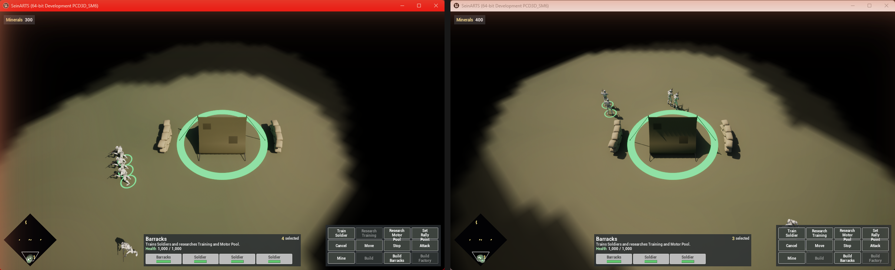

Complete [Create the Main Menu and Lobby](/guides/creating-the-skirmish-lobby/) first. The demo now plays from its menu in the editor. This chapter packages it as a standalone Windows game and plays a match between two copies over the network.

## 1. Prepare the project

1. Compile and save every Blueprint, and save both maps.
2. Select the **Sein Level Volume** in `LVL_Game`, press **Bake Level Data**, and save. The cook takes the baked navigation, minimap and fog data from it. Every player must run a build cooked from the same bake.
3. In **Project Settings > Packaging**, add `LVL_MainMenu` and `LVL_Game` to **List of maps to include in a packaged build**. The cook follows everything those maps reference: units, abilities, effects, widgets, meshes and materials.

## 2. Package for Windows

Use **Platforms > Windows > Package Project**, configuration **Development**, into a folder outside the project's source tree. The same build from the command line:

```powershell
& "<Engine>\Engine\Build\BatchFiles\RunUAT.bat" BuildCookRun -project="<Project>\SeinARTS.uproject" -noP4 -platform=Win64 -clientconfig=Development -build -cook -stage -pak -archive -archivedirectory="<Output>" -unattended
```

Read the end of the packaging log for `BUILD SUCCESSFUL` and check it for errors; an executable in the output folder does not prove the cook succeeded.

The cook stamps a hash of the simulation content into the package. When a match starts, every player's hash must match, so all players run the same package.

## 3. Play against the computer

Run `Windows\SeinARTS.exe` from the output folder. The menu opens. Host, set slot 2 to Computer, Ready and Start, then play the whole loop:

| Action | Expected |
| --- | --- |
| Start | A Barracks, three Soldiers and 500 Minerals |
| Mine | +5 Minerals every 1.5 seconds per Soldier |
| Train Soldier | 50 Minerals; a Soldier appears at the Barracks |
| Research Training, then Motor Pool | 150 and 100 Minerals; Soldiers move and train 30% faster; Build Factory unlocks |
| Build Barracks or Factory | A Soldier walks to the site and builds it |
| Train and load a Truck | Soldiers board; Unload sets them down in a row behind it |
| Fight | Units die, health bars show damage, the AI attacks in groups of four |
| End | Victory or Defeat, then back to the lobby |

## 4. Play two copies over the network

Run two copies of the same package, on one machine or on two machines that can reach each other:

1. The first copy clicks **Host**. On another machine, allow the game through the host's firewall (UDP port `7777`).
2. The second copy enters the host's address (`127.0.0.1` on the same machine, the host's LAN address otherwise) and clicks **Join**. It takes slot 2.
3. Both click **Ready**; the host clicks **Start**.

Play to the end. Check that both copies agree: the same units die, Minerals and production stay in step, transports carry the same passengers, and each player sees only their own fog. Only orders cross the network; each copy runs the same deterministic simulation, and a periodic checksum confirms they agree.

Then leave, host again and play a second match: a working first connection does not prove a complete loop.

## 5. Shipping

Once the Development build passes, package **Shipping** and repeat the menu-to-match test on both copies. Keep the Development package and its logs for investigating problems; Shipping strips most diagnostics.

## Checkpoint

- The package opens the menu and plays the whole loop against the computer.
- Two copies host, join, play a match to its end, and return to the lobby.
- Every player runs a build cooked from the same level bake.
